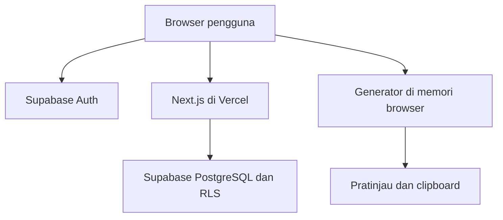

# PRD — Website Template Pesan Customer Service

**Nama kerja:** PesanRapi  
**Versi:** 1.0 — siap menjadi acuan implementasi  
**Tanggal:** 19 Oktober 2026  
**Bahasa produk:** Bahasa Indonesia  
**Target:** website responsif untuk menyusun pesan CS dari template pribadi  
**Cara pengembangan:** solo developer dengan bantuan AntiGravity atau AI coding agent

## 1. Ringkasan produk

PesanRapi membantu customer service membuat pesan profesional tanpa mengetik ulang struktur kalimat yang sama. Pengguna masuk ke akun, memilih template, mengisi data yang diminta, memeriksa hasil, lalu menyalinnya sebagai teks biasa atau teks berformat WhatsApp.

Pengguna dapat membuat dan mengubah template sendiri. Setiap template mempunyai daftar variabel dan pengaturan formulir: label, jenis input, wajib atau opsional, urutan, pilihan dropdown, serta izin mengetik nilai di luar pilihan. Semua template bersifat pribadi per akun.

Halaman kerja sehari-hari harus sederhana. Pengaturan template ditempatkan di halaman terpisah agar pengguna cukup memilih, mengisi, dan menyalin saat melayani pelanggan.

Database menggunakan Supabase Free Plan. Hosting menggunakan Vercel. Penyusunan pesan menggunakan penggantian variabel yang deterministik di browser; aplikasi tidak membutuhkan model AI berbayar saat digunakan.

## 2. Keputusan yang sudah dikonfirmasi

| Aspek | Keputusan |
| --- | --- |
| Hasil pesan | Teks biasa dan format WhatsApp, dapat dipilih |
| Autentikasi | Email dan password saja |
| Penyimpanan | Template dan preferensi akun; tanpa riwayat pesan pelanggan |
| Isolasi data | Satu akun hanya dapat mengakses template miliknya |
| Formulir | Input dapat dikonfigurasi oleh pemilik template |
| Database | Supabase Free Plan |
| Hosting | Vercel |
| Tampilan | Terang, putih, modern, responsif, mengikuti karakter gambar referensi |
| Pengembangan | Diarahkan agar dapat dikerjakan bertahap oleh AI |

**Keputusan desain tambahan dalam PRD ini:** pendaftaran akun mandiri dengan verifikasi email; tidak ada peran admin produk; kategori berupa teks per template; pilihan dropdown tersimpan di template masing-masing. Keputusan ini dapat diubah kemudian tanpa mengubah kebutuhan utama.

**Batas interpretasi “data pelanggan tidak disimpan”:** aplikasi tidak mengirim atau menyimpan nilai formulir generator dan hasil pesan ke backend, penyimpanan browser, URL, analitik, atau log. Template yang sengaja ditulis pengguna tetap disimpan. Aplikasi tidak dapat menjamin teks template bebas data pribadi jika pengguna sendiri memasukkannya ke bagian yang disimpan.

## 3. Masalah, tujuan, dan ukuran keberhasilan

### 3.1 Masalah

- Pesan yang berulang memakan waktu jika diketik atau diedit manual.
- Nama, ID order, produk, dan estimasi waktu mudah tertukar saat menyalin pesan sebelumnya.
- Dokumen template biasa tidak menyediakan formulir yang menyesuaikan kebutuhan pesan.
- Template dan pilihan jawaban berbeda untuk setiap pengguna.

### 3.2 Tujuan

1. Menghasilkan pesan yang konsisten dari data yang diisi pengguna.
2. Mengurangi langkah kerja menjadi pilih template, isi data, lalu salin.
3. Memungkinkan pengguna nonteknis mengatur template dan input tanpa menulis kode.
4. Memisahkan data akun melalui kontrol di database, bukan hanya tampilan.
5. Menjaga agar nilai pelanggan tidak menjadi arsip aplikasi.

### 3.3 Target penerimaan produk

| Indikator | Target awal dan cara memeriksa |
| --- | --- |
| Kecepatan kerja | Template enam input dapat diisi dan disalin dalam ≤45 detik pada simulasi dengan data siap pakai |
| Kecepatan pratinjau | Perubahan hasil terlihat ≤100 ms pada template sampai 20 variabel di perangkat uji |
| Ketepatan substitusi | Seluruh variabel terisi benar, termasuk variabel yang berulang |
| Keamanan akun | Seluruh pengujian akses silang akun ditolak |
| Privasi generator | Tidak ada nilai pelanggan pada request jaringan, storage aplikasi, dan log yang diperiksa |
| Responsivitas | Alur utama selesai pada viewport 360, 390, 768, 1024, dan 1440 px tanpa scroll horizontal halaman |
| Keterpakaian | Semua aksi inti dapat dilakukan dengan keyboard |

Angka waktu di atas adalah target uji, bukan janji performa jaringan. Pengukuran dilakukan dengan data fiktif pada staging; MVP tidak mengumpulkan isi pesan untuk mengukur penggunaan nyata.

## 4. Pengguna dan skenario

**Pengguna utama:** staf customer service yang mempunyai beberapa pola pesan dan sering mengganti data pelanggan.

**Pemilik template:** pengguna yang sama, ketika mengelola kata-kata dan input formulir. Istilah “pengaturan di belakang” berarti halaman pengelolaan milik akun itu sendiri, bukan dashboard admin yang dapat melihat semua akun.

### Skenario utama

1. Pengguna memilih template “Pesanan Mengalami Kendala”.
2. Sistem menampilkan nama pelanggan, nama toko, produk, ID order, detail masalah, dan estimasi waktu.
3. Pengguna mengetik data pelanggan dan ID order, memilih detail masalah, serta memilih atau mengetik estimasi.
4. Pratinjau diperbarui langsung tanpa permintaan ke server.
5. Pengguna memilih mode Teks Biasa atau WhatsApp.
6. Setelah semua input wajib valid, pengguna menekan “Salin Pesan”.
7. Pengguna menempelkan pesan ke aplikasi chat pilihannya.
8. “Pelanggan Baru” menghapus nilai transaksi dan mempertahankan hanya default konfigurasi yang aman, seperti nama toko.

### Cerita pengguna

| ID | Kebutuhan | Hasil yang diharapkan |
| --- | --- | --- |
| US-01 | Saya ingin template pribadi | Akun lain tidak melihat, mengubah, atau menghapusnya |
| US-02 | Saya ingin input menyesuaikan template | Formulir dibuat otomatis dari konfigurasi |
| US-03 | Saya ingin memilih masalah yang sering terjadi | Dropdown dapat dicari dan diatur opsinya |
| US-04 | Saya kadang membutuhkan jawaban baru | Combobox dapat menerima isian tambahan jika diizinkan |
| US-05 | Saya ingin melihat pesan sebelum menyalin | Hasil langsung berubah dan input kosong terlihat |
| US-06 | Saya ingin bold saat menempel ke WhatsApp | Salinan menggunakan penanda format WhatsApp |
| US-07 | Saya tidak ingin data pelanggan menjadi arsip | Refresh, reset, atau keluar halaman membersihkan nilai formulir |
| US-08 | Saya ingin mengedit template dengan aman | Perubahan tersimpan utuh dan konflik antar-tab terdeteksi |

## 5. Ruang lingkup dan prioritas

### 5.1 P0 — wajib untuk rilis pertama

- Daftar akun, verifikasi email, login, logout, lupa password, dan atur ulang password.
- Halaman generator: pilih template, formulir dinamis, pratinjau langsung, mode salin, dan reset pelanggan.
- CRUD template, duplikasi, favorit, arsip, pencarian judul, dan kategori teks.
- Input teks, textarea, dropdown, dan combobox yang mengizinkan isian tambahan.
- Pengaturan label, bantuan, wajib/opsional, urutan, pilihan, dan default konfigurasi.
- Editor teks dengan penyisipan token variabel dan format bold terbatas.
- Supabase Auth, database, RLS, serta validasi definisi template di database.
- Desain responsif, akses keyboard, loading, empty state, error, dan status penyimpanan.
- Perhitungan pesan sepenuhnya di browser dan tanpa penyimpanan data pelanggan.
- Ekspor dan impor JSON konfigurasi template untuk backup manual.

### 5.2 P1 — setelah P0 stabil

- Input tanggal, angka, dan pilihan banyak dengan aturan format yang terdokumentasi.
- Kelola kategori terpusat dan penggantian nama kategori secara massal.
- Pustaka pilihan yang dapat dipakai beberapa template dengan salinan atau referensi yang aman.
- Susun ulang field melalui drag-and-drop; P0 cukup tombol naik/turun.
- Tautan “Buka WhatsApp” hanya jika dibutuhkan, dengan penjelasan bahwa teks dikirim melalui URL tujuan.
- Undo penghapusan, atau pemulihan template dari arsip.

### 5.3 Di luar ruang lingkup

Pengiriman chat otomatis, WhatsApp API, pembacaan chat pelanggan, kontak/CRM, impor pelanggan massal, histori hasil pesan, sinkronisasi clipboard lintas perangkat, langganan berbayar, dashboard pengawas akun, AI penulis ulang saat runtime, lampiran gambar, editor HTML, kolaborasi tim, dan fitur offline penuh.

“Dibuat dengan AI” berarti AI membantu menulis dan memeriksa aplikasi. Ini tidak mewajibkan integrasi API model AI pada produk.

## 6. Struktur halaman dan navigasi

| Route | Isi | Akses |
| --- | --- | --- |
| `/` | Mengarahkan ke generator bila login, selain itu ke login | Publik |
| `/login` | Email, password, tampilkan password, lupa password | Publik |
| `/register` | Email, password, konfirmasi password | Publik |
| `/check-email` | Instruksi verifikasi dan kirim ulang dengan jeda | Publik |
| `/forgot-password` | Form permintaan reset dengan respons netral | Publik |
| `/auth/confirm` | Verifikasi token sesuai alur Supabase; redirect aman | Publik, memvalidasi token |
| `/reset-password` | Password baru; wajib sesi recovery yang valid | Terbatas recovery |
| `/app` | Generator pesan | Login |
| `/app/templates` | Daftar template, cari, kategori, favorit, arsip | Login |
| `/app/templates/new` | Buat template | Login |
| `/app/templates/[id]/edit` | Edit definisi template sendiri | Login dan kepemilikan |
| `/app/settings` | Format output default dan backup template | Login |

Navigasi desktop menggunakan sidebar ramping berisi “Buat Pesan”, “Template Saya”, dan “Pengaturan”. Navigasi mobile memakai header dan menu drawer. Halaman generator selalu menjadi tujuan setelah login; jangan membuat dashboard statistik sebagai halaman awal.

## 7. Spesifikasi generator pesan

### 7.1 Pemilihan template

- Combobox dengan pencarian judul, kategori, dan penanda favorit.
- Favorit ditampilkan dahulu, lalu judul secara alfabetis.
- Hanya template aktif milik akun yang muncul.
- Tidak ada template terpilih secara otomatis pada kunjungan pertama; tampilkan ajakan memilih.
- Sesudah memilih, tampilkan deskripsi singkat dan seluruh input sesuai urutan konfigurasi.
- Berganti template saat formulir berisi nilai pelanggan meminta konfirmasi “Ganti template dan kosongkan isian?”. Tidak memindahkan nilai pelanggan secara otomatis antar-template.
- Jika template dihapus atau diarsipkan dari tab lain, halaman yang terbuka tetap memakai snapshot di memori sampai dimuat ulang; beri informasi saat daftar diperbarui. Tidak ada sinkronisasi realtime P0.

### 7.2 Formulir dinamis

| Jenis | Interaksi | Contoh |
| --- | --- | --- |
| `text` | Ketik satu baris | Nama pelanggan, ID order |
| `textarea` | Ketik beberapa baris | Penjelasan kendala khusus |
| `select` | Pilih satu opsi; opsi dicari bila banyak | Nama toko, jenis kendala |
| `combobox` | Pilih atau ketik nilai baru tanpa menyimpannya otomatis | Produk, estimasi waktu |

Setiap field mempunyai `id`, `key`, `label`, `type`, `required`, `data_class`, `placeholder`, `help_text`, dan `max_length`. Posisi array menentukan urutan.

`options` hanya berlaku untuk select/combobox. `allow_custom` harus `true` pada combobox dan `false` pada select. Nilai tambahan di generator hanya untuk pesan saat itu; untuk menjadikannya pilihan permanen pengguna harus membuka editor template dan menambahkannya secara eksplisit.

`data_class` memiliki dua nilai:

- `transient`: nilai untuk pelanggan/transaksi saat ini; selalu dimulai kosong dan tidak boleh mempunyai default tersimpan.
- `configuration`: nilai umum yang boleh menjadi default template, seperti nama toko atau sapaan umum. Tidak boleh dipakai untuk mengingat pelanggan terakhir.

Pada editor, klasifikasi default adalah `transient`. Pengguna harus sengaja memilih “Konfigurasi umum” untuk mengaktifkan default. Opsi dropdown hanya berisi pilihan reusable; jangan menyimpan daftar pelanggan atau ID order sebagai opsi.

### 7.3 Pratinjau

- Dibuat dari definisi template dan state formulir di browser.
- Tampilkan label variabel dengan gaya placeholder bila belum ada nilainya.
- Hitung jumlah field wajib yang belum terisi dan tampilkan dekat tombol salin.
- Field wajib kosong memblokir salin. Field opsional kosong menjadi string kosong.
- Field opsional tidak otomatis menghilangkan satu paragraf. Pengguna harus mengatur kalimat agar tetap wajar; conditional block ditunda.
- Pertahankan baris baru dan emoji. Normalisasi CRLF menjadi LF.
- Pratinjau teks biasa menampilkan teks akhir tanpa bold. Mode WhatsApp menyediakan tab “Tampilan” dan “Teks yang disalin” agar penanda format dapat diperiksa.
- Tampilkan catatan kecil: “Data isian tidak disimpan. Salin pesan sebelum meninggalkan halaman.”
- P0 tidak menyediakan edit bebas hasil akhir; perubahan dilakukan melalui input atau editor template supaya hasil tetap dapat dijelaskan dari sumbernya.

### 7.4 Salin dan reset

Tombol utama berbunyi “Salin Pesan”. Mode dipilih dengan segmented control “Teks Biasa / WhatsApp”. Gunakan `navigator.clipboard.writeText` hanya melalui tindakan pengguna pada HTTPS. Jika clipboard ditolak, tampilkan dialog berisi hasil yang dapat dipilih lalu disalin manual; jangan menyatakan berhasil sebelum promise selesai [S7].

Toast berhasil: “Pesan berhasil disalin”. Salin tidak mengosongkan formulir; pengguna mungkin perlu menyalin ulang. Tombol “Pelanggan Baru” meminta konfirmasi jika ada nilai transient, lalu membersihkan semua nilai transient dan mengembalikan field konfigurasi ke default template. Fokus diarahkan ke input pertama.

Website tidak dapat menjamin penghapusan clipboard sistem atau riwayat clipboard eksternal. Reset aplikasi tidak menghapus salinan yang sudah dibuat di luar aplikasi.

## 8. Template builder dan pengaturan input

### 8.1 Tata letak builder

Desktop memakai area editor utama dan panel pengaturan/pratinjau. Mobile memakai tab “Isi Pesan”, “Input”, dan “Pratinjau”. Pengguna tidak perlu menulis JSON.

Bagian yang tersedia:

1. Identitas: judul, deskripsi singkat, kategori, favorit.
2. Isi pesan: textarea dengan toolbar bold dan tombol “Sisipkan Variabel”.
3. Daftar input: tambah, edit, hapus, naik, turun.
4. Pratinjau: data contoh fiktif sementara, tidak ikut disimpan.
5. Simpan atau Batal, disertai status perubahan belum disimpan.

### 8.2 Menambah input

Pengguna menentukan label dan jenis. Sistem membuat `key` dari label dengan `snake_case`, lalu menjaganya tetap stabil setelah dibuat. Misalnya “Nama Pelanggan” menghasilkan `nama_pelanggan`. Pengguna dapat mengubah label kapan saja, sedangkan perubahan key dilakukan lewat aksi khusus yang juga mengganti seluruh token terkait secara atomik.

Dialog field memuat status wajib, klasifikasi data, placeholder, bantuan, panjang maksimum, serta daftar opsi jika relevan. Tampilkan peringatan singkat pada default/opsi: “Gunakan nilai umum. Jangan masukkan data pelanggan atau transaksi.”

### 8.3 Pengelolaan variabel

- Token standar adalah `{{nama_pelanggan}}`, bukan teks label berkurung siku.
- Tombol sisip variabel memasukkan token pada posisi kursor.
- Variabel yang dipakai berulang ditampilkan sebagai satu field.
- Token yang belum mempunyai field memblokir penyimpanan dan menyediakan aksi “Buat input”.
- Field yang tidak dipakai di isi pesan juga memblokir penyimpanan; pengguna memilih hapus field atau sisipkan tokennya.
- Menghapus field yang masih dipakai meminta pengguna menghapus/mengganti token terlebih dahulu.
- Mengubah jenis field menghapus konfigurasi yang tidak lagi berlaku setelah konfirmasi, misalnya opsi saat select diubah menjadi text.
- “Ubah key” memeriksa benturan, memperbarui semua token secara terstruktur, dan mempertahankan ID field.

### 8.4 Penyimpanan dan konflik

P0 menggunakan tombol simpan eksplisit. Jangan autosave setiap ketukan. Template baru atau hasil edit disimpan sebagai satu row berisi body dan seluruh field JSONB sehingga tidak terbentuk setengah perubahan.

Setiap template memiliki `version`. Update mengirim `expected_version`; database memperbarui hanya jika versi cocok dan menaikkan versi secara atomik. Jika tidak cocok, tampilkan “Template sudah berubah di tab lain” dengan pilihan muat ulang atau simpan sebagai duplikat. Jangan menimpa perubahan diam-diam.

Navigasi keluar builder dengan perubahan belum disimpan menampilkan konfirmasi. Refresh/menutup tab menggunakan perlindungan `beforeunload` sejauh didukung browser; jangan menjanjikan pemulihan draft setelah tab ditutup.

### 8.5 Operasi daftar template

| Operasi | Aturan |
| --- | --- |
| Buat | Form kosong atau salinan contoh bawaan dengan persetujuan pengguna |
| Edit | Hanya milik akun aktif |
| Duplikasi | UUID baru, judul “Salinan — …”, data pelanggan tidak pernah disertakan |
| Favorit | Mengubah status, tidak membuat salinan |
| Arsip | Hilang dari generator, tetap tersedia di filter arsip |
| Hapus permanen | Konfirmasi judul; setelah berhasil hilang dari database |
| Cari/filter | Berdasarkan judul dan kategori; pencarian tidak mencakup nilai formulir |

Judul yang sama boleh ada karena identitas ditentukan UUID. Berikan peringatan visual agar tidak membingungkan.

## 9. Bahasa template dan aturan format

### 9.1 Grammar P0

Bahasa template mendukung teks biasa, baris baru, `{{key}}`, dan bold `**teks**`. Tidak ada HTML, ekspresi JavaScript, loop, kondisi, evaluasi kode, atau Markdown lengkap.

Key mengikuti pola `[a-z][a-z0-9_]{0,63}`. Token tidak boleh berisi spasi. Parser mengenali teks, variabel, dan bold sebagai node terpisah. Bold tidak bertingkat dan tidak melintasi baris baru; penanda yang tidak berpasangan memblokir penyimpanan.

Escape dalam body: `\*` berarti bintang literal, `\{` berarti kurung kurawal literal, dan `\\` berarti backslash literal. Serializer melakukan escape yang konsisten. Input pelanggan tidak diparsing sebagai body template.

### 9.2 Proses rendering

1. Parse body menjadi struktur node dengan parser kecil dan teruji.
2. Cocokkan key variabel dengan field yang terdaftar.
3. Validasi nilai berdasarkan field.
4. Sisipkan nilai sebagai node teks, satu kali; jangan memindai ulang nilai sebagai token atau markup.
5. Serialisasi ke teks biasa atau format WhatsApp.
6. Tampilkan preview menggunakan node React yang aman, tanpa `dangerouslySetInnerHTML`.

Jangan menjalankan rangkaian `.replace` berulang pada hasil akhir: nilai pelanggan yang mengandung `{{key_lain}}` harus tetap menjadi teks, bukan tersubstitusi lagi. Karakter `$`, backslash, emoji, dan newline harus dipertahankan sebagai data.

### 9.3 Pemetaan format

| Body template | Teks biasa | WhatsApp |
| --- | --- | --- |
| `**Halo Kak {{nama_pelanggan}},**` | `Halo Kak Rina,` | `*Halo Kak Rina,*` |
| `ID Order: **{{id_order}}**` | `ID Order: ORD-00123` | `ID Order: *ORD-00123*` |
| `Terima kasih 🙏` | Sama | Sama |

Penanda satu bintang pada hasil WhatsApp berasal dari node bold, bukan dari penggantian semua bintang di string akhir. Aplikasi menyalin teks berpenanda, bukan mengirim pesan melalui WhatsApp API.

WhatsApp dapat menafsirkan karakter format di dalam nilai pengguna, misalnya `*`, `_`, `~`, dan backtick. P0 mempertahankan nilai asli, menampilkan catatan jika karakter tersebut ditemukan, dan menyediakan mode teks biasa. Jangan mengklaim escaping lintas aplikasi selalu bekerja; lakukan uji tempel nyata sebelum rilis.

### 9.4 Aturan batas dan validasi

| Elemen | Batas aplikasi P0 |
| --- | --- |
| Judul template | 1–100 karakter setelah trim |
| Deskripsi | Maksimal 300 karakter |
| Kategori | Maksimal 50 karakter |
| Body | 1–10.000 karakter; maksimal 30.000 byte UTF-8 |
| Jumlah field | Maksimal 30 per template |
| Label field | 1–80 karakter |
| Bantuan | Maksimal 200 karakter |
| Placeholder | Maksimal 120 karakter |
| Opsi | Maksimal 100 per field; label/value masing-masing 1–150 karakter |
| Nilai text | Default maksimal 200; dapat diatur 1–1.000 karakter |
| Nilai textarea | Default maksimal 1.000; dapat diatur 1–3.000 karakter |
| Hasil akhir | Maksimal 30.000 karakter untuk disalin |
| Definisi JSON field | Maksimal 100.000 byte UTF-8 |
| File impor | Maksimal 1 MiB dan maksimal 50 template per file |

Batas ini adalah keputusan aplikasi, bukan batas resmi pesan WhatsApp. Gunakan satu definisi penghitungan karakter dalam kode: Unicode code point (`Array.from(text).length`) untuk batas UI dan validasi, serta byte UTF-8 untuk batas ukuran. Uji emoji gabungan tanpa mengasumsikan satu emoji selalu satu code point.

Input wajib tidak valid bila kosong atau hanya whitespace. Untuk ID order, gunakan text agar angka nol di depan tidak hilang. Trim spasi luar nilai saat validasi; pertahankan spasi dan baris baru di bagian dalam. Field select hanya menerima value yang terdaftar; combobox menerima value baru jika sesuai panjang maksimum.

## 10. Contoh template utama

### 10.1 Definisi isi pesan

```text
**Halo Kak {{nama_pelanggan}},**
Terima kasih telah berbelanja di {{nama_toko}}.

Kami ingin menginformasikan bahwa saat ini pesanan Kakak dengan **ID Order: {{id_order}}** untuk produk **{{nama_produk}}** sedang mengalami kendala teknis berupa **{{detail_masalah}}**.

Saat ini tim kami sedang berupaya memperbaikinya dengan cepat. Kami mohon kesediaan Kakak untuk menunggu proses ini selama kurang lebih **{{estimasi_waktu}}**.

Kami memohon maaf yang sebesar-besarnya atas ketidaknyamanan yang terjadi. Kami akan segera menghubungi Kakak kembali begitu kendala ini selesai ditangani.

Jika ada pertanyaan lebih lanjut, silakan balas chat ini ya, Kak. Terima kasih atas pengertiannya. 🙏
```

### 10.2 Konfigurasi formulir

| Key | Label | Jenis | Wajib | Klasifikasi | Opsi/default |
| --- | --- | --- | --- | --- | --- |
| `nama_pelanggan` | Nama pelanggan | text | Ya | transient | Kosong |
| `nama_toko` | Nama toko/perusahaan | combobox | Ya | configuration | “Toko Contoh”; boleh diketik ulang |
| `id_order` | ID order | text | Ya | transient | Kosong; placeholder `ORD-00123` |
| `nama_produk` | Nama produk | combobox | Ya | transient | Paket A, Paket B; boleh nilai tambahan |
| `detail_masalah` | Detail kendala | combobox | Ya | transient | Gangguan sistem, transaksi belum terkonfirmasi, stok sedang diperiksa |
| `estimasi_waktu` | Estimasi waktu | combobox | Ya | transient | 15 menit, 30 menit, 1 jam, 1 × 24 jam |

Estimasi waktu adalah teks yang ditentukan pengguna. Aplikasi tidak memperkirakan durasi penyelesaian sendiri dan tidak menambah janji layanan otomatis.

### 10.3 Contoh hasil WhatsApp dengan data fiktif

```text
*Halo Kak Rina,*
Terima kasih telah berbelanja di Toko Contoh.

Kami ingin menginformasikan bahwa saat ini pesanan Kakak dengan *ID Order: ORD-00123* untuk produk *Paket A* sedang mengalami kendala teknis berupa *transaksi belum terkonfirmasi*.

Saat ini tim kami sedang berupaya memperbaikinya dengan cepat. Kami mohon kesediaan Kakak untuk menunggu proses ini selama kurang lebih *30 menit*.

Kami memohon maaf yang sebesar-besarnya atas ketidaknyamanan yang terjadi. Kami akan segera menghubungi Kakak kembali begitu kendala ini selesai ditangani.

Jika ada pertanyaan lebih lanjut, silakan balas chat ini ya, Kak. Terima kasih atas pengertiannya. 🙏
```

### 10.4 Contoh bawaan lain

Sediakan lima contoh tambahan sebagai file statis aplikasi: pesanan diproses, keterlambatan pengiriman, permintaan kelengkapan data, kendala selesai, dan tindak lanjut komplain. Semua memakai data fiktif dan token. Jangan membuat contoh yang mengklaim refund atau kompensasi telah disetujui.

Contoh tidak otomatis disimpan saat login. Pengguna memilih “Gunakan contoh” untuk membuat salinan privat. Tandai `starter_key` pada salinan awal agar impor contoh yang sama dapat dikenali dan tidak terduplikasi akibat klik ganda.

## 11. Desain UI/UX berdasarkan gambar referensi

### 11.1 Karakter visual

Gambar referensi menampilkan kartu putih pada latar abu-abu sangat terang, input berisi abu-abu lembut, border tipis, label gelap, sudut membulat, dan tombol biru berbentuk kapsul. Terapkan karakter tersebut pada alat kerja CS; bentuk kartu pembayaran dalam gambar bukan fitur produk.

Hindari hero besar, ilustrasi dekoratif, statistik kosong, dan banyak panel yang memperlambat alur. Informasi utama pada halaman kerja adalah template terpilih, input, hasil pesan, dan tombol salin.

### 11.2 Token desain

| Token | Nilai awal | Penggunaan |
| --- | --- | --- |
| Background | `#F3F5F6` | Latar halaman |
| Surface | `#FFFFFF` | Kartu dan dialog |
| Input background | `#F7F8FA` | Input dan textarea |
| Border dekoratif | `#D8DEE5` | Kartu dan pemisah |
| Border input | `#7C8998` | Batas kontrol yang harus terlihat jelas |
| Text utama | `#182230` | Judul dan isi |
| Text sekunder | `#526071` | Bantuan dan deskripsi |
| Primary | `#0077B6` | Tombol utama dengan teks putih |
| Primary hover | `#00679E` | Hover tombol |
| Accent dekoratif | `#37BDF3` | Ikon atau highlight ringan; jangan dipakai untuk teks putih kecil |
| Danger | `#B42318` | Error dan hapus |
| Success | `#157347` | Status berhasil |
| Radius kartu | 20–24 px | Kartu utama |
| Radius input | 12–14 px | Formulir |
| Radius tombol | 999 px | Tombol utama/segmented control |
| Spacing | Kelipatan 4 px | Skala 4, 8, 12, 16, 24, 32 |
| Font | Inter atau font sistem sans-serif | Self-host bila memakai font tambahan |

Warna biru sengaja sedikit lebih gelap daripada aksen gambar agar label tombol putih terbaca. Bayangan kartu lembut dan pendek; hindari efek mengambang berlebihan. Verifikasi rasio kontras sebelum rilis, jangan hanya mengandalkan warna yang tampak bagus.

### 11.3 Layout generator

**Desktop ≥1024 px:** sidebar sekitar 208–224 px; konten maksimal sekitar 1.280 px. Setelah header dan pemilih template, area kerja dua kolom: formulir sekitar 45% dan pratinjau sekitar 55%, dengan gap 24 px. Pada layar 1024 px, sidebar dapat runtuh agar ruang formulir cukup. Pratinjau boleh sticky dengan batas tinggi viewport dan scroll internal yang jelas.

**Tablet 768–1023 px:** sidebar menjadi drawer. Formulir dan pratinjau disusun vertikal atau dua kolom bila masing-masing tetap mempunyai lebar nyaman minimal sekitar 320 px. Jangan memaksakan dua kolom.

**Mobile <768 px:** satu kolom dengan padding 16 px. Urutan: judul ringkas, pemilih template, input, mode output, pratinjau. Tombol salin sticky di bawah dengan tinggi yang terukur. Tambahkan padding konten setara tinggi bar plus safe-area agar field terakhir tidak tertutup. Saat keyboard virtual terbuka, tombol tidak boleh menutupi input aktif.

### 11.4 Komponen dan interaksi

- Input dan tombol sentuh minimal 44 px; input utama 46–48 px.
- Label tetap tampil di luar input; placeholder bukan pengganti label.
- Label wajib memiliki penanda dan keterangan yang dapat dibaca screen reader.
- Ikon Lucide dipakai untuk salin, plus, edit, favorit, arsip, dan menu.
- Tombol utama memakai ikon dan teks. Tombol ikon saja memiliki accessible name dan tooltip.
- Fokus keyboard terlihat; pesan error berada dekat field dan terhubung melalui `aria-describedby`.
- Toast ringkas memakai live region, tanpa memindahkan fokus.
- Dialog mengunci fokus dengan benar dan mengembalikannya ke pemicu setelah ditutup.
- Preferensi reduced motion dihormati; animasi hanya 120–180 ms bila membantu.
- Body text 14–16 px; input mobile minimal 16 px untuk mengurangi zoom otomatis browser.

### 11.5 State wajib

| State | Tampilan dan tindakan |
| --- | --- |
| Belum punya template | “Buat template pertama” dan “Gunakan contoh” |
| Belum memilih template | Penjelasan singkat alur, tanpa formulir kosong membingungkan |
| Memuat | Skeleton ringan; jangan tampilkan data akun sebelumnya |
| Form tidak lengkap | Placeholder pada preview dan jumlah field wajib yang kurang |
| Tidak ada hasil pencarian | “Template tidak ditemukan” dan tombol hapus filter |
| Gagal mengambil template | Pesan singkat dan “Coba lagi” |
| Gagal menyimpan | Pertahankan draft builder di memori dan tampilkan retry |
| Sesi habis | Bersihkan data pelanggan sebelum redirect login |
| Clipboard ditolak | Dialog salin manual |
| Jaringan terputus | Generator yang sudah dimuat tetap bisa menghitung dan menyalin; operasi simpan/ambil ditandai gagal |

## 12. Teknologi yang direkomendasikan

Stack dipilih untuk integrasi Vercel dan Supabase, komponen UI yang mudah disesuaikan, serta basis kode TypeScript yang mudah diperiksa AI. Ini keputusan arsitektur untuk kebutuhan produk, bukan klaim bahwa satu stack selalu terbaik untuk semua website.

| Lapisan | Pilihan | Alasan penggunaan |
| --- | --- | --- |
| Framework | Next.js App Router, React, TypeScript strict | Routing, auth server-side, dan deployment Vercel dalam satu proyek [S1] |
| Styling | Tailwind CSS | Token desain dan breakpoint yang konsisten [S2] |
| Komponen | shadcn/ui dengan primitive aksesibel | Form, dialog, combobox, drawer, tooltip [S3] |
| Ikon | Lucide React | Ikon konsisten tanpa aset berat |
| Form | React Hook Form + Zod | Validasi field dinamis dan definisi template |
| Database/Auth | Supabase PostgreSQL + Supabase Auth | Akun email/password dan isolasi row [S4] |
| Supabase SDK | `@supabase/supabase-js`, `@supabase/ssr` | Browser/server client dan sesi cookie [S5] |
| State generator | React state/useReducer | Nilai pelanggan tetap lokal di memori |
| Editor | Textarea + toolbar terbatas + parser kecil | Lebih sederhana daripada editor HTML kaya fitur |
| Unit/integration | Vitest + Testing Library | Parser, schema, state dan interaksi |
| E2E | Playwright | Auth, isolasi akun, mobile, clipboard dan privasi |
| Hosting | Vercel | Deployment aplikasi Next.js |
| Source control | Git repository privat | Histori perubahan, rollback, dan backup kode |
| Package manager | pnpm dengan lockfile | Instalasi dapat direproduksi |

Gunakan rilis stabil yang saling kompatibel saat proyek dimulai, bukan canary/beta. AI wajib mengecek dokumentasi dan menuliskan versi yang benar-benar dipakai di README dan lockfile. Jangan mencampur contoh Next.js/Tailwind dari versi mayor berbeda. Pada Next.js 16 dan sesudahnya periksa penggunaan `proxy.ts`; pada versi lama penamaan dapat berbeda [S5].

Tidak diperlukan Prisma, backend Express terpisah, Redis, Supabase Realtime, Storage bucket, vector database, atau layanan AI untuk P0. SQL migration menjadi sumber kebenaran skema dan RLS.

## 13. Arsitektur dan batas data



Koneksi ke Supabase Auth hanya membawa data autentikasi. Server Next.js membaca dan mengubah definisi template serta preferensi menggunakan identitas pengguna. Generator menerima definisi yang telah dimuat dan memproses nilai pelanggan tanpa request jaringan.

### 13.1 Pemisahan modul

- `template-definition`: tipe, parser, schema field, dan serializer konfigurasi.
- `template-repository`: query template terisolasi akun.
- `template-builder`: editor dan formulir konfigurasi tersimpan.
- `message-generator`: state nilai transient dan rendering hasil; tidak boleh mengimpor modul mutation server.
- `auth`: alur sesi, login, email confirmation, dan recovery.
- `backup`: ekspor/impor definisi template saja.

Pisahkan DTO penyimpanan template dari state generator secara eksplisit. Jangan memakai satu objek besar yang menggabungkan `template`, `values`, dan `output` lalu mengirimkannya ke server.

### 13.2 Penyimpanan yang diizinkan

| Data | Lokasi | Persisten? |
| --- | --- | --- |
| Password | Dikelola Supabase Auth | Ya, melalui mekanisme Auth; bukan tabel aplikasi |
| Sesi autentikasi | Cookie melalui pola resmi Supabase SSR | Ya, khusus autentikasi |
| Body template dan definisi field | Database milik akun | Ya |
| Default konfigurasi dan opsi umum | Di definisi template | Ya |
| Preferensi format output | `user_settings` | Ya |
| Nilai pelanggan/ID order yang diisi | State komponen generator | Tidak |
| Hasil pesan | State turunan/browser clipboard setelah klik | Tidak disimpan aplikasi |
| Data contoh pratinjau builder | State lokal dengan data fiktif | Tidak |
| File ekspor template | File yang sengaja diunduh pengguna | Ya, di luar penyimpanan aplikasi |

### 13.3 Larangan teknis privasi

Nilai generator tidak boleh masuk ke Supabase, server action, form submit native ke server, query parameter, route segment, hash URL, localStorage, sessionStorage, IndexedDB, cookie, service worker cache, error report, session replay, maupun event analitik. Form generator wajib mencegah submit native; tombol salin dan reset memakai `type="button"`. Menekan Enter tidak boleh mengirim nilai ke URL atau server.

Tidak ada tabel `customers`, `messages`, `message_history`, `recent_values`, atau field `last_customer_input`. Browser form memakai `autoComplete="off"` pada input pelanggan sebagai upaya terbaik; browser/extension tetap di luar kontrol aplikasi. Jangan menawarkan “ingat isian terakhir”.

Nilai dibersihkan ketika reset, ganti template yang dikonfirmasi, logout, pergantian akun, sesi tidak valid, keluar route generator, atau remount/refresh. Tangani pemulihan browser back-forward cache melalui lifecycle `pageshow` yang sesuai agar formulir lama tidak muncul kembali. Jangan meletakkan state pelanggan pada layout global yang tetap hidup antar-route.

Jika dua tab aktif dan satu logout, tab lain harus mendeteksi perubahan auth, membersihkan state pelanggan, dan membuang cache template. Kanal sinkronisasi antar-tab boleh hanya mengirim sinyal logout, bukan isi formulir.

## 14. Model database

### 14.1 Strategi skema

P0 memakai dua tabel aplikasi: `templates` dan `user_settings`. Setiap template menyimpan field sebagai JSONB agar perubahan isi dan form menjadi satu unit atomik. Kategori berupa teks di row template; belum memerlukan relasi kategori atau pustaka opsi bersama.

### 14.2 Tabel `templates`

| Kolom | Tipe | Aturan |
| --- | --- | --- |
| `id` | uuid | Primary key, `gen_random_uuid()` |
| `owner_id` | uuid | Wajib, FK `auth.users(id)` dengan cascade delete |
| `title` | text | Batas sesuai bagian 9.4 |
| `description` | text | Default string kosong |
| `category` | text | Default string kosong |
| `body` | text | Template bersintaks terbatas |
| `fields` | jsonb | Array definisi input, tanpa nilai generator |
| `is_favorite` | boolean | Default false |
| `is_archived` | boolean | Default false |
| `starter_key` | text nullable | Identitas contoh bawaan; bukan kepemilikan |
| `schema_version` | integer | Versi format definisi; awal 1 |
| `version` | integer | Optimistic concurrency; awal 1, dinaikkan DB |
| `created_at` | timestamptz | Ditentukan database |
| `updated_at` | timestamptz | Ditentukan database setiap update |

Index: `(owner_id, is_archived, updated_at desc)` dan `(owner_id, category)`. Tambahkan unique partial index `(owner_id, starter_key)` ketika `starter_key is not null`; duplikat manual mengosongkan `starter_key`. Tidak ada index pada nilai pelanggan karena nilai tersebut tidak disimpan.

### 14.3 Tabel `user_settings`

| Kolom | Tipe | Aturan |
| --- | --- | --- |
| `owner_id` | uuid | PK dan FK `auth.users(id)` dengan cascade delete |
| `default_output_mode` | text | `plain` atau `whatsapp`; default `plain` |
| `created_at` | timestamptz | Ditentukan DB |
| `updated_at` | timestamptz | Ditentukan DB |

Row settings dapat dibuat secara lazy pada penyimpanan preferensi pertama. Jika belum ada, aplikasi menggunakan default; tidak perlu trigger yang dapat menggagalkan pendaftaran akun.

### 14.4 Kontrak JSON field

```json
{
  "id": "c27932fa-4914-4fd9-9cc2-8e4c25a48c22",
  "key": "estimasi_waktu",
  "label": "Estimasi waktu",
  "type": "combobox",
  "required": true,
  "data_class": "transient",
  "placeholder": "Pilih atau ketik estimasi",
  "help_text": "Gunakan estimasi yang telah dikonfirmasi tim.",
  "max_length": 150,
  "allow_custom": true,
  "default_value": null,
  "options": [
    { "id": "15m", "label": "15 menit", "value": "15 menit" },
    { "id": "30m", "label": "30 menit", "value": "30 menit" },
    { "id": "1h", "label": "1 jam", "value": "1 jam" }
  ]
}
```

Semua field harus memiliki ID dan key unik dalam satu template. Value opsi harus unik setelah trim dan normalisasi Unicode NFC; perbandingan value case-sensitive. Label boleh berbeda dari value; yang masuk pesan adalah `value`. Preview generator menampilkan keduanya bila berbeda agar pengguna tahu teks yang akan disalin.

### 14.5 Validasi di database

Selain Zod di client/server, migration wajib memasang CHECK atau trigger validator JSONB untuk bentuk array, batas field, properti yang diizinkan, tipe, key/ID unik, batas byte, opsi, serta aturan default. Tolak properti asing seperti `current_value`, `customer_input`, dan `output_message`.

Untuk field transient, `default_value` wajib null. Default konfigurasi pada select harus cocok dengan value opsi; pada combobox mengikuti panjang maksimum. Field text/textarea tidak boleh membawa opsi. Validasi juga memastikan himpunan key dalam body sama dengan himpunan key field.

DB tidak dapat menilai apakah suatu teks statis yang sengaja ditulis pengguna adalah nama pelanggan. Karena itu perlindungan skema harus disertai pemisahan alur builder/generator dan petunjuk penggunaan yang jelas.

## 15. RLS, autentikasi, dan otorisasi

### 15.1 Aturan RLS

Aktifkan RLS untuk kedua tabel. Semua akses pengguna berjalan dengan session JWT miliknya. Jangan mengandalkan `owner_id` yang dikirim client sebagai bukti otorisasi; cocokkan dengan `auth.uid()` di database [S4].

Contoh pola policy untuk tabel template, setelah tabel dibuat:

```sql
alter table public.templates enable row level security;

create policy templates_select_own
on public.templates for select to authenticated
using ((select auth.uid()) = owner_id);

create policy templates_insert_own
on public.templates for insert to authenticated
with check ((select auth.uid()) = owner_id);

create policy templates_update_own
on public.templates for update to authenticated
using ((select auth.uid()) = owner_id)
with check ((select auth.uid()) = owner_id);

create policy templates_delete_own
on public.templates for delete to authenticated
using ((select auth.uid()) = owner_id);
```

Pasang empat policy setara untuk `user_settings` dengan `owner_id`. Jangan membuat policy baca publik. Atur grant tabel/fungsi hanya yang diperlukan; role `anon` tidak diberi operasi data aplikasi. Policy SELECT diperlukan agar UPDATE dapat bekerja dengan benar.

Setiap RPC perubahan template harus `SECURITY INVOKER`, memakai `auth.uid()` dari sesi, dan tetap mengikuti RLS. Bila implementasi memakai fungsi berbeda, AI harus membuktikan tidak ada bypass kepemilikan. Jangan memberikan `service_role` atau secret key ke browser. MVP tidak membutuhkan service key untuk CRUD template.

### 15.2 Alur akun

**Daftar:** email valid, password minimal 12 karakter dengan password manager/paste diperbolehkan, konfirmasi password, lalu kirim verifikasi. Password policy Supabase harus disejajarkan dengan UI. Jangan menyimpan password atau salinannya di tabel aplikasi.

**Login:** email dan password, tombol tampilkan password, pesan gagal netral. Sesi mengikuti mekanisme refresh resmi Supabase SSR; tidak perlu login ulang tiap pergantian halaman.

**Lupa password:** tampilkan respons yang tidak membocorkan keberadaan email. Link recovery menuju URL yang diizinkan. Password baru hanya dapat disimpan setelah token/sesi recovery tervalidasi.

**Logout:** panggil sign out, bersihkan state transient dan cache aplikasi, lalu arahkan ke login. Data pelanggan dibersihkan segera meskipun request logout jaringan gagal; tampilkan kegagalan logout bila sesi belum dapat diakhiri.

### 15.3 SMTP dan email produksi

Konfigurasikan custom SMTP untuk email verifikasi, kirim ulang, dan reset password. SMTP bawaan Supabase ditujukan untuk pengujian dan memiliki pembatasan penerima; jangan menjadikannya dasar email produksi [S6].

Pilih provider SMTP yang mendukung kebutuhan akun dan domain yang tersedia. Biaya provider/domain merupakan komponen terpisah; jangan menjanjikan seluruh proyek nol biaya. Aktifkan SPF/DKIM sesuai provider, template email yang jelas, cooldown resend, dan rate limit Auth. Jangan mematikan verifikasi email agar masalah SMTP terlihat selesai.

### 15.4 Proteksi server dan cache

Gunakan browser client dan server client Supabase yang terpisah sesuai panduan SSR. Verifikasi identitas dengan metode resmi yang sesuai operasi; jangan mempercayai objek sesi atau cookie tanpa verifikasi server. Pertahankan pembaruan cookie dan header refresh dengan benar [S5].

Halaman login pengguna dan data template bersifat dinamis; jangan memakai shared cache/CDN untuk payload akun. Tidak ada `unstable_cache` atau cache global yang key-nya tidak mencakup akun. Gunakan `no-store` untuk respons data privat dan tidak menaruhnya di static generation. Saat pergantian akun, buang seluruh cache akun lama.

Validasi origin/CSRF pada jalur mutation sesuai model Server Actions/Route Handler yang dipilih. Redirect `next` hanya menerima path internal yang diizinkan; tolak URL eksternal. Tidak ada rendering HTML template. Header keamanan dan CSP disesuaikan dengan Next.js dan endpoint Supabase, lalu diuji agar tidak mematahkan auth.

## 16. Kontrak layanan dan perilaku error

P0 memakai repository server dan Server Actions untuk operasi yang memerlukan database. Auth boleh memakai SDK resmi sesuai pola SSR. Tidak ada endpoint `generate-message`.

| Operasi | Input | Hasil |
| --- | --- | --- |
| `listTemplates` | Filter, cursor, limit maks. 50 | Metadata template milik akun tanpa body/fields berat |
| `getTemplate` | UUID template | Definisi lengkap milik akun |
| `createTemplate` | Definisi tervalidasi, request UUID | Template baru; owner dari sesi |
| `updateTemplate` | UUID, expected_version, perubahan | Definisi baru dan version baru |
| `duplicateTemplate` | UUID sumber, UUID baru | Salinan definisi sendiri; tanpa nilai generator |
| `deleteTemplate` | UUID dan expected_version | Sukses atau konflik/tidak tersedia |
| `saveSettings` | Mode default valid | Preferensi akun |
| `importTemplates` | Definisi hasil impor tervalidasi | Hasil per item dan ringkasan |

Untuk create, gunakan UUID yang sama saat retry request yang sama agar timeout tidak menghasilkan duplikat. Update dilakukan melalui RPC compare-and-swap: cek pemilik dan version dalam satu UPDATE, naikkan version di DB, return row baru. Jalur favorit/arsip juga mengikuti version. Jangan melakukan read-versi lalu update tanpa kondisi karena rentan race.

Row tidak ditemukan dan row milik akun lain mendapat pesan sama: “Template tidak tersedia.” Jangan mengungkap bahwa UUID tertentu milik orang lain. Error validasi boleh menunjukkan field definisi yang salah, tanpa mengirim nilai pelanggan.

Standarkan hasil action sebagai union sukses/error dengan kode `VALIDATION_ERROR`, `UNAUTHENTICATED`, `NOT_AVAILABLE`, `CONFLICT`, `RATE_LIMITED`, atau `NETWORK_ERROR`. Pesan untuk pengguna tetap bahasa Indonesia; detail internal hanya kode, operasi, dan request ID, tanpa body template atau formulir.

## 17. Backup, ekspor, dan impor

Backup manual termasuk P0 karena konfigurasi template merupakan aset kerja utama. Ekspor mengambil template yang dipilih atau seluruh template akun melalui akses terotorisasi, lalu membuat JSON di browser.

Format file:

```json
{
  "format": "pesanrapi-template-backup",
  "schema_version": 1,
  "exported_at": "2026-10-19T12:00:00Z",
  "templates": [
    {
      "title": "Contoh singkat",
      "description": "Pesan sapaan",
      "category": "Umum",
      "body": "Halo Kak {{nama_pelanggan}}, terima kasih.",
      "fields": [
        {
          "id": "f4df3b23-1836-4243-9b66-d11dfd4d87a2",
          "key": "nama_pelanggan",
          "label": "Nama pelanggan",
          "type": "text",
          "required": true,
          "data_class": "transient",
          "placeholder": "Nama pelanggan",
          "help_text": "",
          "max_length": 200,
          "allow_custom": false,
          "default_value": null,
          "options": []
        }
      ],
      "is_favorite": false,
      "is_archived": false
    }
  ]
}
```

File tidak membawa owner ID, token, password, nilai generator, hasil pesan, ataupun data contoh preview. Pada impor, parse sebagai data, validasi keseluruhan struktur, tampilkan ringkasan, dan minta aksi “Impor” sebelum menyimpan. Template diimpor sebagai salinan dengan UUID dan pemilik akun saat ini; tidak boleh menimpa berdasarkan owner/id dalam file.

P0 mengimpor item secara berurutan dengan hasil per item. Jika sebagian gagal, tampilkan mana yang berhasil dan gagal; retry hanya item gagal menggunakan UUID request yang sama. Jangan mengklaim transaksi seluruh file atomik jika implementasinya per item. Tolak versi masa depan yang belum didukung serta file berlebih sebelum mengirim data.

Ekspor ini mencadangkan definisi template, bukan backup penuh Auth/database. Cadangan operasional database dan kode merupakan tanggung jawab pengelola proyek. Free Plan tidak menyediakan fasilitas backup produksi yang sama dengan paket berbayar [S8].

## 18. Performa, keandalan, dan batas layanan

### 18.1 Strategi hemat resource

- Render ulang pesan lokal; tidak ada request pada setiap pengetikan generator.
- Daftar template mengambil metadata dengan pagination, bukan seluruh body semua akun.
- Ambil definisi lengkap saat dipilih; cache hanya di memori selama sesi akun.
- Pencarian daftar dikirim dengan debounce sekitar 300 ms bila dilakukan server-side.
- Simpan builder secara eksplisit; hindari autosave per karakter.
- Jangan menambah polling atau realtime tanpa kebutuhan yang terbukti.
- Tidak memakai Storage karena P0 berbasis teks.
- Tidak membuat cron keep-alive untuk menghindari kebijakan pause layanan.

### 18.2 Target teknis

Halaman generator siap dioperasikan dalam target ≤3 detik pada profil jaringan uji yang disepakati setelah sesi valid. Evaluasi target Core Web Vitals LCP ≤2,5 detik, INP ≤200 ms, CLS ≤0,1 pada pengujian yang representatif. Angka ini sasaran optimasi dan perlu diverifikasi, bukan SLA Supabase Free.

Setelah definisi termuat, kehilangan jaringan tidak menghentikan rendering dan penyalinan lokal. Login, memuat template lain, menyimpan, dan impor tetap memerlukan jaringan. Jangan tampilkan indikator “tersimpan” sebelum konfirmasi server.

### 18.3 Supabase Free Plan

Dokumentasi yang diperiksa pada tanggal PRD mencantumkan database 500 MB, 50.000 MAU, egress 5 GB, serta kemungkinan pause setelah satu minggu tidak aktif. Resource ini cukup layak sebagai titik awal aplikasi berbasis teks, tetapi kapasitas nyata bergantung jumlah template dan penggunaan [S8].

Pantau ukuran database dan pemakaian egress melalui dashboard layanan. Jika proyek pause, operator memulihkannya melalui dashboard Supabase; aplikasi menampilkan kegagalan koneksi dengan retry, bukan menganggap template hilang.

### 18.4 Hosting Vercel

Hosting tetap Vercel sesuai kebutuhan. Pisahkan skenario prototipe pribadi nonkomersial dan penggunaan operasional perusahaan: Vercel membatasi Hobby untuk penggunaan pribadi nonkomersial. Untuk alat operasional CS perusahaan, jangan mengasumsikan Hobby memenuhi ketentuan; pilih paket yang sesuai penggunaan, misalnya Pro [S9].

Biaya potensial terdiri dari paket hosting yang sesuai, SMTP/domain, dan upgrade Supabase jika kebutuhan meningkat. AI tidak boleh mengubah hosting pilihan pengguna atau mengaktifkan pembelian layanan secara otomatis.

## 19. Persiapan yang perlu disediakan pengembang

| Kebutuhan | Digunakan untuk |
| --- | --- |
| Akun dan proyek Supabase | Database dan Auth |
| Akun Vercel dengan paket sesuai penggunaan | Hosting |
| Repository Git privat | Source, migration, dan deployment |
| Provider SMTP serta sender/domain terverifikasi | Verifikasi email dan password recovery |
| Nama aplikasi sementara | Identitas UI dan email |
| Template dan opsi awal yang bebas data pelanggan | Seed contoh privat |
| Gambar referensi UI | Acuan gaya kartu, input, warna dan jarak |
| Dua akun uji dengan email berbeda | Pembuktian RLS |

Jika memakai Node lokal, gunakan versi LTS yang memenuhi persyaratan Next.js yang dipilih. Gunakan package manager tunggal dan lockfile. AI dapat mengerjakan kode, konfigurasi contoh, dan migration; pengelola tetap perlu menyediakan kredensial dan menjalankan verifikasi domain/account yang memerlukan kepemilikan.

Environment aplikasi yang diharapkan:

```dotenv
NEXT_PUBLIC_SUPABASE_URL=https://YOUR_PROJECT.supabase.co
NEXT_PUBLIC_SUPABASE_PUBLISHABLE_KEY=YOUR_PUBLISHABLE_KEY
APP_URL=http://localhost:3000
```

Gunakan nama key yang sesuai proyek Supabase yang aktual; apabila proyek lama memakai anon key, dokumentasikan perbedaannya. Publishable key boleh tersedia di browser karena akses data tetap dibatasi JWT dan RLS. Secret/service key tidak boleh memiliki awalan `NEXT_PUBLIC_` dan tidak diperlukan pada MVP.

SMTP dikonfigurasikan di Supabase Auth, bukan diletakkan dalam source frontend. `.env.example` hanya berisi placeholder; `.env.local` tidak masuk Git. Pisahkan environment development/staging dari production sejauh resource memungkinkan.

## 20. Rencana implementasi untuk AntiGravity atau AI coding agent

Kerjakan per tahap dengan checkpoint yang dapat diuji. Jangan membuat seluruh produk sekaligus lalu hanya memeriksa halaman awal.

| Tahap | Pekerjaan | Syarat selesai |
| --- | --- | --- |
| 1. Fondasi | Bootstrap Next.js, TypeScript, UI token, komponen dasar, route shell | Build dan typecheck lulus; tampilan responsif dasar |
| 2. Engine lokal | Schema field, parser token/bold, validator, renderer plain/WhatsApp | Unit test kasus normal dan edge case lulus |
| 3. Data dan Auth | Migration, RLS, login/register/recovery, SMTP staging | Dua akun tidak bisa saling mengakses data |
| 4. Builder | CRUD atomik, field editor, dropdown, default, konflik versi | Template contoh dibuat dari UI dan tersimpan utuh |
| 5. Generator | Pilih template, form dinamis, preview, copy, reset | Enam input contoh bekerja tanpa request nilai pelanggan |
| 6. Backup dan state | Ekspor/impor, favorit, arsip, empty/error/offline state | Round-trip konfigurasi berhasil tanpa data generator |
| 7. QA dan deploy | E2E, aksesibilitas, responsive, staging lalu produksi | Seluruh kriteria rilis bagian 23 terpenuhi |

### 20.1 Struktur kode yang disarankan

```text
src/app/                         Routes, layout, Server Actions
src/components/ui/               Komponen dasar
src/features/auth/               Form dan alur Auth
src/features/templates/          Builder, daftar, repository
src/features/generator/          State transient dan formulir generator
src/features/backup/             Import/export definisi
src/lib/supabase/                Client browser/server dan refresh sesi
src/lib/template-engine/         Parser, AST, validator, serializer
src/lib/validation/              Schema definisi dan preferensi
supabase/migrations/             Tabel, constraint, policy, RPC
supabase/tests/                  Pemeriksaan RLS dan validasi DB
tests/e2e/                       Alur browser
```

Penempatan `proxy.ts`/`middleware.ts` mengikuti versi framework yang benar-benar dipilih. Struktur folder adalah panduan, bukan alasan menambah abstraksi yang belum diperlukan.

### 20.2 Hasil kerja yang wajib diserahkan AI

- Source aplikasi yang dapat dijalankan, bukan hanya mockup.
- SQL migration lengkap dan prosedur menjalankannya.
- Contoh environment tanpa rahasia.
- README setup lokal, Auth/SMTP, Vercel, backup, rollback, dan troubleshooting.
- Data contoh fiktif dan contoh template statis.
- Unit test engine serta pengujian RLS dan E2E yang relevan.
- Lockfile, generated database types, dan catatan versi dependency.
- Hasil verifikasi ringkas: apa yang lulus, gagal, atau belum dapat diuji beserta alasannya.

## 21. Matriks pengujian wajib

| ID | Pengujian | Hasil yang wajib |
| --- | --- | --- |
| AUTH-01 | Daftar dan verifikasi email | Akun bisa login setelah verifikasi |
| AUTH-02 | Password salah dan email tidak dikenal | Pesan netral, tidak membocorkan akun |
| AUTH-03 | Recovery valid, kedaluwarsa, dan token rusak | Hanya recovery valid dapat mengubah password |
| AUTH-04 | Refresh sesi dan logout antar-tab | Sesi sesuai alur resmi; data transient dibersihkan |
| RLS-01 | Akun A membaca UUID template B melalui SDK langsung | Tidak ada row B dikembalikan |
| RLS-02 | Akun A mengubah/menghapus template B | Tidak ada perubahan data B |
| RLS-03 | Insert owner_id akun lain | Ditolak DB |
| RLS-04 | Request tanpa login pada kedua tabel | Tidak mendapat data atau hak tulis |
| RLS-05 | Akses settings akun lain dan RPC bypass | Ditolak meskipun UI dilewati |
| DEF-01 | Token tidak dikenal, key ganda, bold rusak | Simpan ditolak dengan lokasi masalah |
| DEF-02 | Default pada transient dan properti asing | Ditolak validator DB melalui request langsung |
| GEN-01 | Enam field contoh dan variabel berulang | Seluruh substitusi tepat |
| GEN-02 | Required berisi spasi dan opsional kosong | Required memblokir; opsional menjadi kosong |
| GEN-03 | ID `000123`, Unicode, emoji, newline | Nilai tidak berubah secara tidak sengaja |
| GEN-04 | Input `{{nama_toko}}`, `$&`, HTML, dan script | Tetap teks; tidak dieksekusi/diinterpretasi ulang |
| GEN-05 | Select ilegal dan combobox custom | Select ditolak; custom diterima sesuai aturan |
| FMT-01 | Bold plain dan WhatsApp | Plain tanpa marker, WhatsApp memakai marker node yang tepat |
| FMT-02 | Nilai mengandung marker WhatsApp | Nilai dipertahankan dan informasi format muncul |
| CLIP-01 | Clipboard sukses dan permission ditolak | Toast hanya saat sukses; manual fallback tersedia |
| PRIV-01 | Ketik sentinel fiktif unik lalu salin | Sentinel tidak muncul di request jaringan |
| PRIV-02 | Periksa DB/log/storage setelah GEN-01 | Tidak ada nilai atau hasil generator |
| PRIV-03 | Reset, pindah route, refresh, back-forward, logout | Nilai pelanggan kosong pada kunjungan kembali |
| PRIV-04 | Akun A logout lalu akun B login di browser sama | Tidak ada template/state A yang muncul |
| SAVE-01 | Dua tab mengedit versi sama | Update kedua konflik; tidak menimpa diam-diam |
| SAVE-02 | Timeout saat create dan retry | Tidak tercipta salinan kedua dari request sama |
| BACK-01 | Ekspor dan impor ulang | Definisi ekuivalen; UUID dan owner baru |
| BACK-02 | Impor rusak, versi tidak didukung, file besar | Ditolak tanpa partial write tak terjelaskan |
| BACK-03 | Impor sebagian gagal | Ringkasan akurat dan retry hanya item gagal |
| UI-01 | Viewport target dan keyboard virtual | Tidak ada field/tombol yang tertutup |
| A11Y-01 | Keyboard, fokus dialog, label, kontras | Alur inti bisa diselesaikan tanpa mouse |
| NET-01 | Putus jaringan setelah template dimuat | Preview/copy lokal berjalan, save menunjukkan gagal |

Uji privasi jaringan mencakup request ke domain aplikasi, Supabase, dan layanan eksternal. Gunakan sentinel yang jelas fiktif; artefak rekaman test tidak boleh membawa data pelanggan nyata. Pemeriksaan DB dilakukan melalui akun pengelola di staging hanya untuk membuktikan tidak ada nilai tersimpan.

## 22. Deployment, operasi, dan rollback

### 22.1 Urutan deployment

1. Siapkan proyek Supabase dan jalankan migration versi terkontrol.
2. Verifikasi RLS menggunakan dua akun dan jalur SDK langsung.
3. Konfigurasikan Auth Site URL, daftar redirect terbatas, email verification, SMTP, dan rate limit.
4. Deploy preview Vercel dengan environment staging dan data fiktif.
5. Jalankan build, typecheck, lint, unit/integration, dan E2E yang relevan.
6. Uji verifikasi email dan recovery dari domain staging yang benar.
7. Periksa salinan plain/WhatsApp dengan tempel nyata, responsive, dan network privacy.
8. Siapkan environment produksi, jalankan migration yang disetujui, lalu deploy source yang sudah lulus.
9. Uji singkat produksi dengan data fiktif dan pantau error teknis tanpa isi pesan.

Jangan mengarahkan seluruh preview acak ke database produksi. Jangan memakai wildcard redirect produksi yang terlalu luas. Auth callback harus mempertahankan pertukaran token yang sesuai panduan Supabase dan tidak membuka open redirect.

### 22.2 Observabilitas minimal

Catat hanya kode error, nama operasi, durasi, dan request ID. Jangan log request body, password, access token, email pengguna, body template, input, atau hasil pesan. Tidak ada session replay atau analytics pada generator P0.

Gunakan dashboard Supabase/Vercel untuk kapasitas dan gangguan. Tidak perlu dashboard monitoring khusus di dalam produk. Jika email gagal, tampilkan informasi netral dan periksa konfigurasi SMTP; jangan menonaktifkan verifikasi sebagai perbaikan cepat.

### 22.3 Rollback

Rollback frontend melalui deployment sebelumnya. Migration database dibuat kompatibel mundur jika memungkinkan; jangan mengandalkan rollback frontend untuk membatalkan perubahan skema. Sebelum perubahan data yang destruktif, lakukan backup operasional yang memadai. P0 tidak menjalankan penghapusan atau migrasi destruktif otomatis saat aplikasi start.

## 23. Kriteria rilis / Definition of Done

Produk boleh dinyatakan selesai ketika:

- Pengguna dapat register, verifikasi, login, reset password, dan logout melalui email/password.
- Setiap akun terbukti hanya dapat membaca dan mengubah template serta settings sendiri, termasuk melalui request langsung.
- Pengguna dapat membuat contoh enam field melalui UI tanpa mengedit source atau JSON.
- Jenis input dapat diganti; pilihan dan izin custom berperilaku sesuai konfigurasi.
- Template dan field tersimpan atomik, dan konflik versi ditangani.
- Preview, required validation, plain copy, WhatsApp copy, dan clipboard fallback bekerja.
- Nilai pelanggan dan hasil tidak muncul pada database, request jaringan, storage aplikasi, log, atau ekspor.
- Reset dan lifecycle halaman membersihkan nilai sesuai kontrak privasi.
- Ekspor/impor mencadangkan definisi template dan tidak mengambil alih owner dari file.
- UI mengikuti referensi visual serta lulus viewport, keyboard, fokus, dan kontras yang diuji.
- Error/loading/empty/offline state berfungsi; tidak ada tombol inti palsu atau data mock pada alur produksi.
- Build, typecheck, lint, dan pengujian relevan lulus. Pemeriksaan yang belum dapat dijalankan dinyatakan terbuka, bukan dilaporkan lulus.
- README menjelaskan SMTP, batas Free Plan, paket Vercel sesuai penggunaan, backup, dan cara menjalankan migration.

## 24. Prompt awal untuk AI pembangun

Salin bagian berikut bersama seluruh PRD ini ke AntiGravity atau AI coding agent:

```text
Anda bertindak sebagai senior full-stack engineer dan product designer.
Implementasikan website PesanRapi sesuai PRD terlampir. Jangan hanya membuat
mockup. Gunakan Next.js App Router, React, TypeScript strict, Tailwind CSS,
shadcn/ui, Supabase Auth/PostgreSQL, dan deployment Vercel. Periksa versi stabil
dan dokumentasi resmi sebelum menentukan dependency, lalu kunci lockfile.

Prioritas alur produk:
pilih template pribadi -> isi formulir dinamis -> lihat preview -> salin plain
atau WhatsApp. Login hanya email/password. Halaman utama harus sederhana.
Builder dan pengaturan input dipisahkan dari generator.

Nilai pelanggan dan hasil pesan hanya boleh berada di state browser. Tidak ada
history, localStorage, sessionStorage, request generate, analytics payload,
log input, atau penyimpanan nilai pelanggan dalam default template. Pisahkan
tipe/DTO template tersimpan dari state generator. Input pelanggan tidak boleh
diinterpretasi kembali sebagai token, HTML, atau markup aplikasi.

Terapkan RLS pada semua tabel. Uji dengan dua akun dan SDK langsung. Gunakan
session pengguna untuk CRUD, bukan service-role key. Body dan fields disimpan
atomik; update memakai version compare-and-swap. Validasi JSONB harus tetap
berjalan di database meskipun UI dilewati.

Ikuti karakter gambar: putih, abu-abu terang, input lembut, sudut membulat,
aksen biru, ikon modern, dan layout responsif. Utamakan aksesibilitas dan
pastikan tombol sticky tidak menutup field di mobile.

Mulai dengan memeriksa repository yang ada, lalu buat rencana tahap 1–7 sesuai
PRD. Kerjakan satu tahap sampai dapat diverifikasi sebelum beralih. Jangan
mengganti Supabase atau Vercel, menambah AI API, framework backend lain, atau
fitur P1 tanpa kebutuhan. Jangan menaruh kredensial di source.

Serahkan source, migration, .env.example, README, data contoh fiktif, dan hasil
pengujian. Jelaskan kendala yang memerlukan konfigurasi akun/domain secara
spesifik. Jangan menyatakan fitur selesai jika masih memakai mock atau belum
diuji. Ketika ada detail kecil yang belum ditentukan, pilih implementasi paling
sederhana yang memenuhi PRD dan catat keputusannya.
```

## 25. Referensi teknis resmi

Referensi diperiksa pada 19 Oktober 2026. Kuota, ketentuan paket, SDK, dan panduan framework dapat berubah; periksa kembali saat implementasi dan sebelum deployment produksi. Rincian arsitektur, batas aplikasi, dan prioritas produk dalam PRD adalah keputusan rancangan, bukan kutipan dokumentasi provider.

- **[S1] Next.js — Installation:** https://nextjs.org/docs/app/getting-started/installation
- **[S2] Tailwind CSS — Next.js framework guide:** https://tailwindcss.com/docs/installation/framework-guides/nextjs
- **[S3] shadcn/ui — Next.js:** https://ui.shadcn.com/docs/installation/next
- **[S4] Supabase — Row Level Security:** https://supabase.com/docs/guides/database/postgres/row-level-security
- **[S5] Supabase — SSR client setup:** https://supabase.com/docs/guides/auth/server-side/creating-a-client?queryGroups=framework&framework=nextjs
- **[S6] Supabase — Custom SMTP:** https://supabase.com/docs/guides/auth/auth-smtp
- **[S7] MDN — Clipboard.writeText:** https://developer.mozilla.org/en-US/docs/Web/API/Clipboard/writeText
- **[S8] Supabase — Pricing dan production checklist:** https://supabase.com/pricing dan https://supabase.com/docs/guides/deployment/going-into-prod
- **[S9] Vercel — Hobby dan fair use:** https://vercel.com/docs/plans/hobby dan https://vercel.com/docs/limits/fair-use-guidelines
