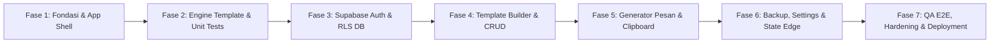

# Rencana & Urutan Pengerjaan Bertahap (Roadmap) — PesanRapi

**Dokumen Acuan:** [PRD PesanRapi v1.0 (GEMINI.md)](file:///Users/syaifulloh/Documents/Pemrograman/Web/CSCentre/GEMINI.md)  
**Tujuan Dokumen:** Membagi implementasi proyek menjadi beberapa fase terstruktur, terisolasi, dan dapat diverifikasi bertahap oleh pengguna (tidak dikerjakan sekaligus/monolitik).  
**Status:** Siap dieksekusi bertahap.

---

## 1. Filosofi & Aturan Eksekusi Bertahap

1. **Satu Fase pada Satu Waktu:** Pekerjaan hanya dilakukan pada fase aktif. Fase berikutnya tidak boleh dimulai sebelum fase saat ini lulus checkpoint pengujian dan disetujui oleh pengguna.
2. **Prinsip Nol Kebocoran Privasi (*Zero-Storage Privacy*):** Nilai input pelanggan, hasil pesan, dan data transient hanya boleh berada di memori browser lokal (*component state*). Tidak boleh ada log, network payload, local/session storage, atau tabel database untuk data pelanggan.
3. **Pemisahan DTO Tersimpan vs State Generator:** Struktur database (`templates`) hanya menyimpan definisi template dan konfigurasi umum, tidak pernah bercampur dengan state pengisian pesan.
4. **Verifikasi Keamanan di Database (Bukan Hanya UI):** Row Level Security (RLS) dan validasi JSONB harus melindungi data bahkan jika UI dilewati.
5. **No Mock di Tahap Rilis:** Setiap fase menghasilkan kode nyata yang berfungsi, lulus typecheck, lulus linter, dan teruji.

---

## 2. Gambaran Ringkas 7 Fase Pengerjaan

| Fase | Nama Fase | Fokus Utama | Target Deliverable |
| :--- | :--- | :--- | :--- |
| **Fase 1** | **Fondasi, Design System & App Shell** | Setup Next.js, TypeScript strict, Tailwind tokens, shadcn/ui, layout navigasi | Kerangka UI responsif, navigasi desktop & mobile |
| **Fase 2** | **Core Engine & Validasi Lokal** | Parser token `{{key}}`, formatting bold `**`, serializer plain & WhatsApp, validator Zod | Engine deterministik teruji 100% unit tests |
| **Fase 3** | **Database, RLS & Autentikasi** | Migrasi SQL, JSONB check, RLS policies, auth SSR, login/register/recovery | Dua akun terisolasi penuh, sesi aman |
| **Fase 4** | **Template Builder & Manajemen Template** | CRUD template atomik, field editor, version CAS lock, list/filter | User bisa membuat template 6 input dari UI |
| **Fase 5** | **Generator Pesan & Salin Clipboard** | Dynamic form generator, real-time preview, copy plain/WA, reset | Alur kerja utama CS siap pakai & privasi terjamin |
| **Fase 6** | **Backup, Settings & Edge States** | Ekspor/impor JSON, starter templates, user settings, empty/offline | Fitur pendukung lengkap & bebas partial write |
| **Fase 7** | **QA E2E, Hardening & Deployment** | Playwright E2E, aksesibilitas WCAG, audit viewport, Vercel/Supabase guide | Produk siap produksi memenuhi Definition of Done |

---

## 3. Rincian Detail Setiap Fase

---

### Fase 1: Fondasi Proyek, Design System & App Shell

#### 1.1 Tujuan
Membangun fondasi aplikasi Next.js App Router dengan TypeScript strict, mengonfigurasi token desain visual sesuai PRD Bagian 11 (kartu putih, border abu-abu lembut, aksen tombol biru kapsul), serta menyediakan shell navigasi desktop (sidebar) dan mobile (drawer).

#### 1.2 Rincian Tugas (Step-by-Step)
1. **Inisialisasi Project:**
   - Inisialisasi Next.js (App Router, TypeScript strict mode, ESLint).
   - Setup Tailwind CSS dan pastikan konfigurasi lockfile bersih (`pnpm-lock.yaml` atau `package-lock.json`).
   - Setup library komponen UI berbasis Radix/shadcn primitive dan Lucide React.
2. **Design System & Token Styling:**
   - Definisikan token warna di CSS/Tailwind:
     - Background: `#F3F5F6`
     - Surface / Card: `#FFFFFF` (radius 20–24px, subtle short shadow)
     - Input Background: `#F7F8FA`
     - Border Input: `#7C8998`
     - Border Card/Divider: `#D8DEE5`
     - Primary Action: `#0077B6` (hover `#00679E`, radius kapsul 999px, text `#FFFFFF`)
     - Text Primary: `#182230`, Text Secondary: `#526071`
     - Danger: `#B42318`, Success: `#157347`
   - Setup font Inter / modern system sans-serif.
3. **App Shell & Layout:**
   - Komponen Sidebar Desktop (lebar 208–224px): "Buat Pesan" (`/app`), "Template Saya" (`/app/templates`), "Pengaturan" (`/app/settings`).
   - Komponen Mobile Header & Drawer: Menu responsif dengan trigger hamburger, safe-area aware.
   - Halaman placeholder untuk semua route publik & terproteksi (`/`, `/login`, `/register`, `/app`, `/app/templates`, `/app/settings`).
4. **Tooling & Linter:**
   - Konfigurasi linting, formatting, dan typechecking command (`npm run typecheck`, `npm run lint`).

#### 1.3 Checkpoint & Kriteria Kelulusan (Gate to Fase 2)
- [ ] `npm run build` dan `npm run typecheck` berhasil tanpa error.
- [ ] Tampilan halaman responsif diuji pada lebar 360px, 768px, 1024px, dan 1440px tanpa horizontal scrollbar.
- [ ] Sidebar desktop dan drawer mobile bekerja mulus dengan animasi ringan (≤180ms).
- [ ] Tidak ada warning CSS atau dependency yang bertabrakan.

---

### Fase 2: Core Template Engine & Validasi Lokal (Zero-Network)

#### 2.1 Tujuan
Mengembangkan pustaka parser dan renderer template deterministik yang berjalan murni di memori browser. Mesin ini bertugas memproses token `{{key}}`, formatting `**bold**`, karakter escape, serta validasi Unicode tanpa memanggil server atau AI API runtime.

#### 2.2 Rincian Tugas (Step-by-Step)
1. **Definisi Type & Schema Zod (`src/lib/template-engine/types.ts` & `src/lib/validation/`):**
   - Schema field: `id`, `key`, `label`, `type` (`text` | `textarea` | `select` | `combobox`), `required`, `data_class` (`transient` | `configuration`), `placeholder`, `help_text`, `max_length`, `allow_custom`, `default_value`, `options`.
   - Aturan validasi batas karakter (PRD 9.4):
     - Unicode code point counter (`Array.from(text).length`).
     - Key pattern: `^[a-z][a-z0-9_]{0,63}$`.
     - Transient field wajib `default_value: null`.
2. **Parser Template (`src/lib/template-engine/parser.ts`):**
   - AST Parser non-regex recursive/lexer untuk mengenali node: `TextNode`, `VariableNode`, `BoldNode`.
   - Parsing karakter escape: `\*` -> bintang literal, `\{` -> kurung kurawal literal, `\\` -> backslash literal.
   - Bold tidak boleh bersarang dan tidak boleh melintasi baris baru (newline). Penanda bold yang tidak berpasangan harus ditolak sebagai syntax error.
3. **Renderer & Substitusi Deterministik (`src/lib/template-engine/renderer.ts`):**
   - Renderer Plain Text: Menghilangkan penanda bold, mengganti variabel dengan nilai input.
   - Renderer WhatsApp: Mengubah bold menjadi format `*teks*`.
   - Pencegahan re-evaluasi (Security & Determinism): Nilai input pelanggan yang mengandung token `{{key_lain}}`, backslash, `$`, atau script **tidak boleh** diparsing ulang sebagai markup template.
4. **Template Contoh Statis (`src/lib/template-engine/starters.ts`):**
   - 1 template utama kendala pesanan (6 input: nama_pelanggan, nama_toko, id_order, nama_produk, detail_masalah, estimasi_waktu).
   - 5 template statis tambahan (pesanan diproses, keterlambatan pengiriman, permintaan data, kendala selesai, tindak lanjut komplain).
5. **Unit Tests Vitest (`src/lib/template-engine/__tests__/`):**
   - Test suite komprehensif mencakup DEF-01, GEN-01 s/d GEN-05, FMT-01, FMT-02.

#### 2.3 Checkpoint & Kriteria Kelulusan (Gate to Fase 3)
- [ ] 100% Vitest unit tests pass untuk semua skenario:
  - Variabel berulang terisi seragam.
  - Penanda bold valid dan deteksi error jika bold tidak berpasangan.
  - Karakter khusus (`$`, backslash, emoji, newline) tidak terkorupsi.
  - Nilai transient dengan `default_value` ditolak oleh validator schema.
  - Token tanpa field atau field tanpa token ditolak.

---

### Fase 3: Database Supabase, RLS & Autentikasi

#### 3.1 Tujuan
Menyiapkan basis data Supabase PostgreSQL, membuat migrasi skema tabel `templates` dan `user_settings`, mengaktifkan Row Level Security (RLS) dengan isolasi ketat antar-akun, serta membangun alur autentikasi email & password lengkap (daftar, verifikasi email, login, lupa password, reset password, logout).

#### 3.2 Rincian Tugas (Step-by-Step)
1. **Migrasi SQL & Skema Database (`supabase/migrations/`):**
   - Tabel `templates`: `id`, `owner_id`, `title`, `description`, `category`, `body`, `fields` (JSONB), `is_favorite`, `is_archived`, `starter_key`, `schema_version`, `version`, `created_at`, `updated_at`.
   - Index: `(owner_id, is_archived, updated_at desc)`, `(owner_id, category)`, unique partial index `(owner_id, starter_key)`.
   - Tabel `user_settings`: `owner_id`, `default_output_mode`, `created_at`, `updated_at`.
   - Constraint / Trigger Validator JSONB: Validasi struktur array `fields`, tolak field ilegal seperti `customer_input`, `current_value`, atau `output_message`.
2. **Kebijakan Row Level Security (RLS):**
   - Pasang RLS pada `templates` dan `user_settings` untuk `SELECT`, `INSERT`, `UPDATE`, `DELETE` menggunakan `auth.uid() = owner_id`.
   - Pastikan role `anon` tidak memiliki hak akses baca/tulis ke data aplikasi.
   - Buat fungsi RPC aman (`SECURITY INVOKER`) untuk update dengan optimis concurrency (version compare-and-swap).
3. **Integrasi Supabase SSR di Next.js (`src/lib/supabase/`):**
   - Setup `@supabase/ssr` untuk Browser Client, Server Client, dan Proxy/Middleware untuk sinkronisasi sesi cookie secara resmi.
   - Environment variables: `NEXT_PUBLIC_SUPABASE_URL`, `NEXT_PUBLIC_SUPABASE_PUBLISHABLE_KEY`, `APP_URL`. (Tidak ada service_role key di frontend).
4. **Alur UI Autentikasi (`src/features/auth/`):**
   - `/register`: Email, password (min. 12 karakter), konfirmasi password.
   - `/check-email`: Instruksi verifikasi dan cooldown kirim ulang.
   - `/login`: Email, password, tombol lihat password, pesan gagal netral.
   - `/forgot-password`: Permintaan reset password dengan pesan netral.
   - `/auth/confirm`: Handler verifikasi token/link verifikasi Supabase.
   - `/reset-password`: Form password baru yang hanya aktif dengan sesi recovery valid.
   - Aksi Logout: Memanggil sign out, membuang sesi cookie, dan membersihkan seluruh state di memori.
5. **Pengujian Isolasi Akun:**
   - Verifikasi RLS-01 sampai RLS-05 dengan 2 akun uji berbeda.

#### 3.3 Checkpoint & Kriteria Kelulusan (Gate to Fase 4)
- [ ] User A dapat mendaftar, verifikasi email, dan login.
- [ ] Sesi login bertahan melalui cookie refresh resmi Supabase SSR.
- [ ] Script pengujian membuktikan: Akun A tidak dapat membaca, mengubah, atau menghapus template milik Akun B (RLS terbukti).
- [ ] Pengisian field terlarang pada JSONB langsung ditolak oleh database constraint/trigger.

---

### Fase 4: Template Builder & Manajemen Template

#### 4.1 Tujuan
Membangun antarmuka pengelolaan template (`/app/templates`), pembuatan template baru (`/app/templates/new`), dan pengeditan template (`/app/templates/[id]/edit`) dengan pengeditan field dinamis, pencegahan konflik versi (optimistic locking), serta penyimpanan atomik ke Supabase.

#### 4.2 Rincian Tugas (Step-by-Step)
1. **Server Actions Terisolasi (`src/features/templates/actions/`):**
   - `listTemplates`: Mengambil metadata template terpaginasi (tanpa membebani bandwidth dengan body/fields besar).
   - `getTemplate`: Mengambil definisi lengkap satu template milik akun aktif.
   - `createTemplate`: Menyimpan template baru secara atomik (dengan request UUID untuk idempotensi).
   - `updateTemplate`: Update dengan version compare-and-swap (tolak jika versi tidak cocok).
   - `duplicateTemplate`: Membuat salinan dengan UUID baru dan judul "Salinan — ...".
   - `deleteTemplate`: Hapus permanen dengan konfirmasi judul dan pengecekan versi.
2. **Daftar Template (`/app/templates`):**
   - List/Grid template dengan pencarian judul dan filter kategori (debounce 300ms).
   - Tanda bintang untuk Favorit dan status Arsip.
   - Aksi cepat: Edit, Duplikasi, Arsipkan, Hapus.
3. **Template Builder UI (`/app/templates/new` & `[id]/edit`):**
   - Form Identitas: Judul, deskripsi singkat, kategori teks, toggle favorit.
   - Message Editor: Textarea dengan toolbar tombol bold `**` dan tombol "Sisipkan Variabel" pada posisi kursor aktif.
   - Field Manager:
     - Tambah, edit, hapus, naikkan/turunkan urutan field.
     - Auto snake_case generator dari label ke key (misal "Nama Pelanggan" -> `nama_pelanggan`).
     - Form dialog field: tipe (text, textarea, select, combobox), required, data_class (`transient` vs `configuration`), placeholder, help_text, max_length, opsi select/combobox.
     - Peringatan privasi jelas di modal field: *"Gunakan nilai umum. Jangan masukkan data pelanggan atau transaksi."*
   - Real-time Builder Sync: Memblokir penyimpanan jika ada token di pesan yang belum memiliki field, atau field yang tidak terpakai di pesan.
   - Pratinjau Sementara Builder: Menampilkan simulasi pesan dengan data contoh fiktif (tidak disimpan ke DB).
4. **Proteksi Tab & Konflik Versi:**
   - Optimistic lock handler: Jika versi database lebih tinggi dari `expected_version`, tampilkan dialog "Template sudah berubah di tab lain" (opsi muat ulang atau simpan sebagai duplikat).
   - Proteksi navigasi `beforeunload` jika terdapat perubahan yang belum disimpan.

#### 4.3 Checkpoint & Kriteria Kelulusan (Gate to Fase 5)
- [x] Pengguna dapat membuat template 6 input (kasus kendala pesanan) melalui UI tanpa menyentuh kode/JSON.
- [x] Body pesan dan seluruh array field tersimpan secara atomik dalam satu row di tabel `templates`.
- [x] Uji SAVE-01: Buka template di dua tab, edit tab 1 lalu simpan, edit tab 2 lalu simpan -> tab 2 memunculkan deteksi konflik.
- [x] Duplikasi template menghasilkan row baru dengan UUID baru tanpa membawa data riwayat.

---

### Fase 5: Generator Pesan & Interaksi Clipboard

#### 5.1 Tujuan
Membangun halaman utama kerja customer service (`/app`), yang terdiri dari pemilih template, formulir dinamis yang digenerate otomatis dari konfigurasi field, pratinjau pesan real-time, copy ke clipboard (format Teks Biasa & WhatsApp), serta reset form "Pelanggan Baru" dengan jaminan nol penyimpanan data pelanggan.

#### 5.2 Rincian Tugas (Step-by-Step)
1. **Pemilihan Template (`src/features/generator/components/TemplateSelector.tsx`):**
   - Combobox pencarian template dengan pengelompokan Favorit di atas, disusul abjad.
   - Mengambil definisi lengkap template ke memori saat dipilih.
   - Modal konfirmasi jika mengganti template saat formulir sudah berisi data pelanggan.
2. **Formulir Dinamis Generator (`src/features/generator/components/DynamicForm.tsx`):**
   - Render input sesuai jenis: `text`, `textarea`, `select`, dan `combobox` (mengizinkan ketik bebas).
   - Input memakai `autoComplete="off"`, `type="button"` pada tombol aksi, dan mencegah submit native (`e.preventDefault()`).
   - Validasi required secara visual, bantuan `help_text`, dan counter karakter.
3. **State Management Lokal (`src/features/generator/hooks/useGeneratorState.ts`):**
   - State tersimpan murni di React state (`useReducer` / `useState`).
   - Tidak ada koneksi ke localStorage, sessionStorage, IndexedDB, atau URL query params.
   - Siklus hidup pembersihan: Reset form, ganti template, logout, navigasi keluar route, atau event `pageshow` (back-forward cache) langsung mengosongkan nilai pelanggan.
4. **Pratinjau Pesan Real-Time (`src/features/generator/components/MessagePreview.tsx`):**
   - Pembaruan hasil seketika (target ≤100ms) saat user mengetik.
   - Visualisasi placeholder jika variabel wajib belum diisi, beserta counter jumlah field wajib yang belum lengkap.
   - Segmented control pemilih format: "Teks Biasa" vs "WhatsApp".
   - Tab pada mode WhatsApp: Tab "Tampilan" (pratinjau visual) dan Tab "Teks Disalin" (menampilkan penanda bintang `*teks*`).
   - Pesan kecil: *"Data isian tidak disimpan. Salin pesan sebelum meninggalkan halaman."*
5. **Aksi Salin & Reset (`src/features/generator/components/GeneratorActions.tsx`):**
   - Tombol utama "Salin Pesan" (disabled jika ada field wajib yang belum terisi).
   - Eksekusi `navigator.clipboard.writeText`. Jika permission ditolak, buka Dialog Fallback Salin Manual dengan textarea terpilih (CLIP-01).
   - Toast sukses: *"Pesan berhasil disalin"*.
   - Tombol "Pelanggan Baru" (Reset): Konfirmasi pembersihan, kosongkan semua nilai transient, kembalikan field konfigurasi ke default template, arahkan fokus ke input pertama.
6. **Mobile Layout Polish:**
   - Sticky action bar di bagian bawah mobile dengan padding yang memperhitungkan safe-area dan virtual keyboard (tidak menutupi input aktif).

#### 5.3 Checkpoint & Kriteria Kelulusan (Gate to Fase 6)
- [x] Pengguna dapat mengisi 6 input contoh, melihat pratinjau instan, dan menyalin format plain maupun WhatsApp.
- [x] Uji Privasi Jaringan (PRIV-01 & PRIV-02): Saat mengisi formulir dan menyalin, tidak ada request jaringan yang membawa string isian pelanggan ke server/Supabase.
- [x] Uji Lifecycle Privasi (PRIV-03 & PRIV-04): Refresh halaman, klik "Pelanggan Baru", atau logout langsung menghapus nilai pelanggan dari memori.
- [x] Salin manual fallback bekerja ketika izin clipboard browser diblokir.

---

### Fase 6: Backup, Pengaturan Akun & Edge States

#### 6.1 Tujuan
Mengimplementasikan fitur ekspor/impor JSON untuk backup definisi template, pengaturan preferensi akun (`user_settings`), starter template bawaan, serta penanganan kondisi batas (empty state, loading skeleton, error handling, dan offline readiness).

#### 6.2 Rincian Tugas (Step-by-Step)
1. **Halaman Pengaturan Akun (`/app/settings`):**
   - Pilihan default output mode: "Teks Biasa" atau "WhatsApp" (disimpan di tabel `user_settings`).
   - Ringkasan akun (email aktif, status sesi).
2. **Ekspor & Impor Definisi Template (`src/features/backup/`):**
   - **Ekspor:** Menghasilkan file JSON format `pesanrapi-template-backup` (schema version 1) berisi definisi template milik akun yang dipilih/semua. File tidak memuat owner_id, nilai pelanggan, atau token rahasia.
   - **Impor:** Upload JSON, validasi skema file, tampilkan ringkasan jumlah template valid, minta konfirmasi, lalu simpan per item dengan UUID dan owner baru sesuai akun yang sedang login.
   - Pencegahan error parsial: Jika sebagian gagal, tampilkan laporan item yang gagal dan izinkan retry hanya pada item gagal tanpa menduplikasi yang berhasil.
3. **Pemuatan Template Contoh Bawaan (Starter Templates):**
   - Tombol "Gunakan Contoh Bawaan" pada empty state daftar template.
   - Salin starter templates ke akun pengguna dengan penanda `starter_key` untuk mencegah duplikasi ganda.
4. **State Khusus (PRD Bagian 11.5):**
   - Empty state: Belum punya template, belum memilih template, hasil pencarian kosong.
   - Loading state: Skeleton loader lembut (tanpa flash data akun sebelumnya).
   - Offline / Disconnected state: Generator yang sudah terbuka tetap bisa melakukan substitusi dan salin pesan meski internet terputus (NET-01).

#### 6.3 Checkpoint & Kriteria Kelulusan (Gate to Fase 7)
- [x] Ekspor dan impor ulang file JSON menghasilkan definisi template yang identik dengan UUID dan owner akun aktif (BACK-01).
- [x] File backup yang korup atau versi tidak didukung ditolak dengan pesan error yang jelas (BACK-02).
- [x] Preferensi format default di `/app/settings` diterapkan otomatis saat generator pertama kali dibuka.
- [x] Pemutusan koneksi internet saat generator terbuka tidak menghentikan fungsi preview dan salin pesan.

---

### Fase 7: QA Menyeluruh, Hardening & Kesiapan Rilis

#### 7.1 Tujuan
Melakukan pengujian menyeluruh (End-to-End dengan Playwright, audit aksesibilitas, verifikasi responsivitas, audit privasi jaringan), merapikan dokumentasi operasional (README, panduan SMTP, mitigasi limit Supabase Free & Vercel), serta mempersiapkan deployment produksi sesuai *Definition of Done* (PRD Bagian 23).

#### 7.2 Rincian Tugas (Step-by-Step)
1. **Pengujian Otomatis E2E (Playwright):**
   - Script E2E untuk alur: Register -> Login -> Buat Template -> Buka Generator -> Isi Data -> Salin Pesan -> Reset Pelanggan.
   - E2E Test Isolasi Akun: Akun A mencoba mengakses route dan ID template Akun B.
   - E2E Test Sentinel Privasi: Ketik string unik khusus (`CUSTOMER_SECRET_12345`), pantau lalu lintas jaringan (HAR/requests), pastikan string tersebut tidak pernah dikirim ke URL/server manapun.
2. **Audit Aksesibilitas & Responsivitas:**
   - Navigasi penuh menggunakan keyboard (Tab, Enter, Space, Escape, Arrow keys).
   - Focus trap pada dialog modal (dialog field, dialog konfirmasi reset, dialog manual copy).
   - Uji kontras warna teks terhadap background (WCAG AA).
   - Uji mobile pada viewport 360px, 390px, 768px, 1024px, 1440px.
3. **Pembersihan Kode & Security Hardening:**
   - Konfigurasi Security Headers di Next.js (Content Security Policy, X-Content-Type-Options, X-Frame-Options, Referrer-Policy).
   - Verifikasi tidak ada data mock atau placeholder tersisa di alur produksi.
   - Pastikan logging server hanya mencatat kode error dan request ID, tanpa body template, input, atau kredensial.
4. **Dokumentasi Operasional (`README.md`):**
   - Panduan konfigurasi Supabase (migrasi SQL, custom SMTP, Auth redirect URL).
   - Panduan deployment ke Vercel dan setup environment variables.
   - Catatan batasan Supabase Free Plan (database 500MB, pause inactivity) dan mitigasinya.
   - Prosedur backup dan pemulihan data template.

#### 7.3 Checkpoint & Kriteria Kelulusan (Release / DoD Checklist)
- [x] Seluruh kriteria dalam PRD Bagian 23 (Definition of Done) terpenuhi:
  - Auth lengkap email/password & recovery.
  - RLS terbukti menolak akses silang akun.
  - Template 6 input bekerja mulus.
  - Nilai pelanggan nol jejak di server/storage.
  - Build produksi lulus bersih tanpa lint/typecheck error.
- [x] Laporan pengujian akhir diserahkan kepada pengguna untuk persetujuan rilis.

---

## 4. Matriks Traceability Pengujian PRD

Berikut adalah pemetaan test ID wajib dari PRD Bagian 21 ke fase pengerjaan yang bertanggung jawab:

| Test ID | Deskripsi Skenario Pengujian | Fase Penanggung Jawab | Kriteria Kelulusan |
| :--- | :--- | :--- | :--- |
| **AUTH-01** | Daftar akun dan verifikasi email | Fase 3 | Akun baru bisa login setelah verifikasi email |
| **AUTH-02** | Password salah & email tidak terdaftar | Fase 3 | Pesan gagal netral, tidak membocorkan keberadaan email |
| **AUTH-03** | Token recovery valid, expired, dan rusak | Fase 3 | Hanya token recovery valid yang diizinkan ubah password |
| **AUTH-04** | Refresh sesi & logout antar-tab | Fase 3 & Fase 5 | Sesi cookie di-refresh otomatis; logout membersihkan state |
| **RLS-01** | Akun A baca template Akun B via SDK | Fase 3 | Query langsung mengembalikan 0 row / tolak |
| **RLS-02** | Akun A ubah/hapus template Akun B | Fase 3 | Mutasi ditolak database RLS |
| **RLS-03** | Insert row dengan owner_id akun lain | Fase 3 | Ditolak oleh WITH CHECK policy |
| **RLS-04** | Request anonim tanpa token login | Fase 3 | Ditolak total pada tabel templates & user_settings |
| **RLS-05** | Akses settings akun lain via RPC | Fase 3 | Ditolak, tidak bisa memotong RLS |
| **DEF-01** | Token tidak dikenal / bold tidak berpasangan | Fase 2 & Fase 4 | Simpan ditolak dengan informasi lokasi kesalahan |
| **DEF-02** | Default value pada field transient / properti ilegal | Fase 2 & Fase 3 | Ditolak oleh validator Zod dan DB constraint |
| **GEN-01** | Enam field contoh dan variabel berulang | Fase 2 & Fase 5 | Seluruh substitusi variabel tepat 100% |
| **GEN-02** | Field required kosong / hanya whitespace | Fase 2 & Fase 5 | Blokir tombol salin pesan; field opsional jadi string kosong |
| **GEN-03** | Format ID `000123`, emoji, dan newline | Fase 2 & Fase 5 | Nilai teks tidak berubah atau terpotong |
| **GEN-04** | Input berisi `{{key}}`, `$`, script, HTML | Fase 2 & Fase 5 | Tetap teks mentah, tidak dievaluasi ulang |
| **GEN-05** | Select opsi tidak terdaftar & combobox custom | Fase 2 & Fase 5 | Select ilegal ditolak; combobox custom diterima |
| **FMT-01** | Bold mode Plain vs WhatsApp | Fase 2 & Fase 5 | Plain bersih dari simbol; WhatsApp menggunakan `*bold*` |
| **FMT-02** | Nilai input mengandung simbol formatting WA | Fase 2 & Fase 5 | Nilai input dipertahankan, muncul catatan informasi format |
| **CLIP-01** | Salin clipboard sukses vs izin ditolak | Fase 5 | Toast saat sukses; modal dialog manual copy saat ditolak |
| **PRIV-01** | Ketik sentinel unik fiktif lalu salin | Fase 5 & Fase 7 | Sentinel tidak pernah muncul di inspeksi network request |
| **PRIV-02** | Periksa DB, storage, log setelah salin pesan | Fase 5 & Fase 7 | Tidak ada riwayat pesan atau input tersimpan |
| **PRIV-03** | Reset form, pindah halaman, back-forward cache | Fase 5 | Form kembali bersih / default konfigurasi |
| **PRIV-04** | Akun A logout lalu Akun B login di browser sama | Fase 3 & Fase 5 | Tidak ada sisa template atau isian Akun A |
| **SAVE-01** | Dua tab mengedit template versi sama | Fase 4 | Tab kedua menolak overwrite karena version conflict |
| **SAVE-02** | Retry request create template akibat timeout | Fase 4 | Idempotent UUID mencegah pembuatan baris duplikat |
| **BACK-01** | Ekspor dan impor ulang template | Fase 6 | Template terimpor dengan UUID & owner baru |
| **BACK-02** | Impor file JSON rusak atau skema salah | Fase 6 | Ditolak sebelum mutasi data database |
| **BACK-03** | Impor file sebagian gagal | Fase 6 | Laporan item akurat; retry hanya untuk item yang gagal |
| **UI-01** | Tampilan mobile & keyboard virtual aktif | Fase 1 & Fase 5 | Tombol sticky tidak menutupi input yang sedang diketik |
| **A11Y-01** | Navigasi keyboard penuh & focus trap dialog | Fase 5 & Fase 7 | Alur kerja utama dapat selesai tanpa menggunakan mouse |
| **NET-01** | Jaringan internet mati setelah template dibuka | Fase 5 & Fase 6 | Generator lokal tetap bisa render pesan dan salin clipboard |

---

## 5. Panduan Memulai Eksekusi

Saat Anda siap memulai pengerjaan, instruksikan AI dengan perintah:
> **"Mulai kerjakan Fase 1"**

AI akan:
1. Menyiapkan kerangka proyek Next.js, TypeScript strict, Tailwind CSS dengan token PRD Bagian 11, dan App Shell navigasi.
2. Menjalankan verifikasi mandiri (build, typecheck, layout responsif).
3. Melaporkan hasil checkpoint Fase 1 kepada Anda untuk dievaluasi dan disetujui sebelum beralih ke Fase 2.
