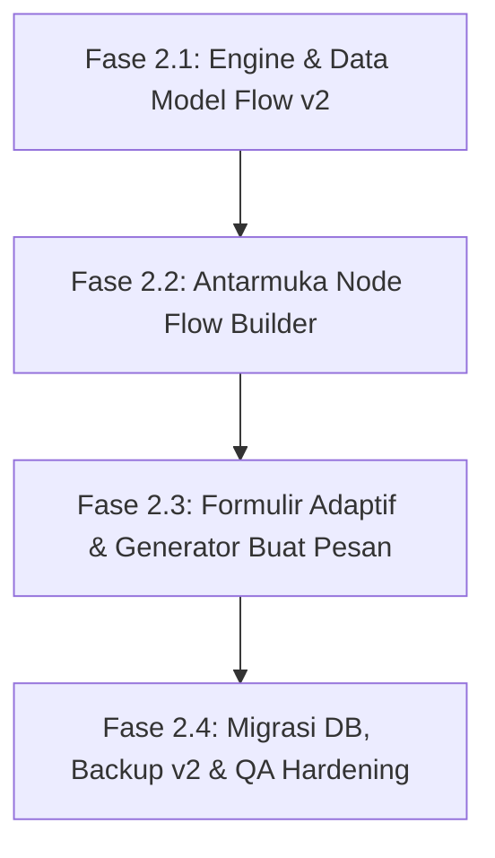

# Rencana Arsitektur & Pengerjaan v2: Node-Based Dynamic Flow Template

Dokumen ini merinci perencanaan arsitektur, pemodelan data, dan tahapan pengerjaan untuk mentransformasi **PesanRapi** dari sistem template statis linear menjadi **Sistem Template Percabangan Dinamis Berbasis Node (Dynamic Decision Tree / Flow Builder)**.

---

## 1. Analisis Kebutuhan & Konsep Utama

### 1.1 Masalah pada Sistem Linear (v1)
- Setiap template hanya memiliki satu teks body statis dan daftar field formulir yang kaku.
- Dalam operasional *Customer Service* nyata, satu kendala memiliki banyak skenario cabang. Contoh:
  - Kendala "Pesanan":
    - Jika CS memilih *Paket Hilang* $\rightarrow$ butuh teks investigasi ekspedisi, butuh input *Nomor Resi*, dan pertanyaan boolean *Apakah Asuransi Aktif?*.
      - Jika Asuransi = *Ya* $\rightarrow$ muncul teks klaim ganti rugi 100%.
      - Jika Asuransi = *Tidak* $\rightarrow$ muncul teks kompensasi standar.
    - Jika CS memilih *Produk Rusak* $\rightarrow$ butuh teks retur/tukar barang, butuh input *Kondisi Paket* dan *Keterangan Video Unboxing*.
- Pada sistem statis, membuat kemungkinan di atas mengharuskan CS memiliki puluhan template terpisah yang membingungkan.

### 1.2 Solusi: Sistem Node & Form Dinamis (v2)
1. **Struktur Template Berbasis Node (Percabangan):**
   - Template terdiri dari satu atau lebih **Node** yang saling terhubung.
   - Setiap Node memiliki:
     - Teks pesan untuk bagian tersebut (misal: Sapaan pembuka, Solusi kendala, Prosedur klaim, Penutup).
     - Variabel/input yang diperlukan di node tersebut.
     - Aturan percabangan (*Branching Rule*): Menentukan node tujuan berikutnya berdasarkan jawaban pengguna pada input dropdown atau Ya/Tidak.
2. **Penyederhanaan & Penambahan Tipe Variabel:**
   - Pembuatan variabel dipermudah: langsung tentukan nama/token (contoh: `{{Order ID}}`).
   - Dukungan tipe kontrol lengkap:
     - `text`: Teks Singkat (Nama, ID Order, dll.)
     - `textarea`: Teks Panjang (Detail masalah, Catatan khusus)
     - `select`: Menu Dropdown Pilihan Kaku
     - `combobox`: Menu Dropdown + Ketik Baru
     - `number`: Nomor / Angka (Jumlah produk, Hari, Nominal)
     - `boolean`: Ya / Tidak (Switch / Radio / Dropdown Ya-Tidak)
3. **Formulir Adaptif & Pratinjau Real-Time di Halaman "Buat Pesan" (`/app`):**
   - Formulir bertahap/adaptif: Saat CS memilih opsi di formulir, formulir berikutnya muncul atau hilang sesuai alur node yang dipilih.
   - Pratinjau pesan di sebelah kanan otomatis menyusun dan menyambungkan teks dari seluruh node aktif secara *real-time*.
   - **Tetap mempertahankan Zero-Storage:** Seluruh penentuan jalur node dan isian pelanggan berjalan murni di memori browser React, tanpa jejak di database atau log.

---

## 2. Struktur Data Model (Template Flow v2)

```typescript
export type FieldTypeV2 = "text" | "textarea" | "select" | "combobox" | "number" | "boolean";

export interface FlowFieldDefinition {
  id: string;
  key: string;              // snake_case token, misal: nama_pelanggan
  label: string;            // Label UI, misal: Nama Pelanggan
  type: FieldTypeV2;        // text, textarea, select, combobox, number, boolean
  required: boolean;
  data_class: "transient" | "configuration";
  placeholder: string;
  help_text: string;
  max_length: number;
  default_value: string | null;
  options: { id: string; label: string; value: string }[];
}

export interface FlowBranchCondition {
  operator: "equals";
  value: string;            // Nilai yang memicu cabang (misal: "Paket Hilang" atau "true")
  targetNodeId: string;     // ID Node berikutnya yang akan disambungkan
}

export interface FlowNode {
  id: string;
  title: string;            // Judul langkah/node, misal: "Pilihan Jenis Kendala"
  body: string;             // Kalimat pesan pada node ini (bisa memuat {{token}} dan **bold**)
  fields: FlowFieldDefinition[];
  // Variabel yang dijadikan penentu cabang ke node berikutnya (opsional)
  branchingFieldKey?: string; 
  branches: FlowBranchCondition[]; // Daftar cabang ke node lain
  defaultNextNodeId?: string;      // Node lanjutan jika tidak ada percabangan khusus
}

export interface TemplateFlowDefinition {
  id: string;
  owner_id?: string;
  title: string;
  description: string;
  category: string;
  is_favorite: boolean;
  is_archived: boolean;
  schema_version: 2;        // Versi 2 untuk Flow Node
  version: number;
  rootNodeId: string;       // Node awal/pembuka
  nodes: FlowNode[];        // Seluruh node dalam alur
  created_at?: string;
  updated_at?: string;
}
```

---

## 3. Rencana Pembagian Fase Pengerjaan

Untuk memastikan setiap bagian dibangun dengan rapi, bebas bug, dan dapat diverifikasi secara bertahap, perubahan besar ini dibagi menjadi **4 Fase Eksekusi**:



---

### 🔹 Fase 2.1: Engine & Data Model Flow v2 (Logika & Evaluator Alur)
**Tujuan:** Membangun core logic penentuan jalur node (*path traversal*), stitching teks gabungan, dan validasi tipe data baru (`number`, `boolean`).

**Pekerjaan:**
1. Mendefinisikan tipe TypeScript dan skema Zod untuk `FlowNode`, `FlowBranchCondition`, `FlowFieldDefinition` (`number`, `boolean`), dan `TemplateFlowDefinition`.
2. Membuat **Flow Evaluator Engine** (`src/lib/template-engine/flow-evaluator.ts`):
   - Menerima `TemplateFlowDefinition` dan `userAnswers: Record<string, string>`.
   - Menghitung urutan *activeNodes* dari `rootNodeId` berdasarkan pilihan pengguna.
   - Mengumpulkan seluruh field yang relevan pada jalur aktif saat itu.
   - Menyambungkan (*stitch*) teks pesan dari seluruh node aktif secara deterministik (mode WhatsApp & Plain).
3. Menyiapkan Starter Template Flow Percabangan: "Kendala Pesanan Dinamis" (Paket Hilang vs Produk Rusak vs Salah Kirim).
4. Menulis unit test lengkap (100% test coverage untuk multi-path branching, boolean evaluation, dan cyclic protection).

---

### 🔹 Fase 2.2: Antarmuka Visual Node Flow Builder (`/app/templates/new` & `[id]/edit`)
**Tujuan:** Membangun antarmuka pembuatan dan pengeditan template berbasis node yang mudah dipahami tanpa perlu kemampuan coding.

**Pekerjaan:**
1. **Navigasi & Visualisasi Alur Node:**
   - Panel daftar Node/Langkah (Node Pembuka, Cabang A, Cabang B, Penutup).
   - Indikator visual koneksi antar-node (misal: *"Jika Jenis Kendala = Paket Hilang $\rightarrow$ lanjut ke Langkah: Investigasi Ekspedisi"*).
2. **Editor Node Komprehensif:**
   - Input judul node dan teks pesan spesifik node tersebut dengan toolbar Bold `**` dan tombol Sisip Variabel.
   - Pengelola variabel yang disederhanakan: Tambah variabel langsung pilih tipe (Teks Singkat, Teks Panjang, Dropdown, Ketik Baru/Combobox, Nomor/Angka, Ya/Tidak).
3. **Pengaturan Percabangan (Branch Rules):**
   - Dropdown memilih field penentu cabang (khusus field bertipe `select` atau `boolean`).
   - Tabel pemetaan: `Nilai Pilihan` $\rightarrow$ `Lanjut ke Node Mana`.
4. **Pratinjau Interaktif Builder:**
   - Simulasi alur langsung di builder untuk menguji percabangan sebelum disimpan.

---

### 🔹 Fase 2.3: Formulir Adaptif & Generator Pesan Dinamis (`/app`)
**Tujuan:** Mentransformasi halaman "Buat Pesan" agar formulirnya adaptif (bertambah/berkurang sesuai pilihan) dan pratinjau pesan berubah otomatis secara real-time.

**Pekerjaan:**
1. **Dynamic Step/Branch Form (`DynamicFlowForm.tsx`):**
   - Menampilkan formulir input yang hanya aktif pada jalur node yang dipilih.
   - Input bertipe `boolean` dirender dengan toggle switch atau pilihan Ya/Tidak yang elegan.
   - Input bertipe `number` memiliki validasi angka dan formatting.
   - Saat pengguna mengubah pilihan dropdown percabangan, field yang tidak lagi relevan otomatis disembunyikan/dibersihkan dari pesan.
2. **Real-time Live Preview:**
   - Pratinjau pesan di sebelah kanan langsung menampilkan gabungan teks dari seluruh langkah yang telah dipilih.
   - Pilihan format: WhatsApp (`*teks*`) dan Teks Biasa.
3. **Penyalinan & Siklus Hidup "Pelanggan Baru":**
   - Tombol Salin Pesan aktif hanya jika semua field wajib pada *jalur aktif* sudah lengkap.
   - Tombol "Pelanggan Baru" membersihkan seluruh input dan mengembalikan formulir ke langkah awal (Root Node).

---

### 🔹 Fase 2.4: Migrasi DB, Backup v2 & Kesiapan Rilis
**Tujuan:** Menjaga kompatibilitas database, format backup, dan verifikasi menyeluruh.

**Pekerjaan:**
1. **Kompatibilitas Skema Database:**
   - Memperbarui migration SQL Supabase agar tabel `templates` mengenali `schema_version = 2` (struktur nodes flow) dengan tetap mempertahankan dukungan terhadap template v1 yang sudah ada (*backward compatibility*).
2. **Ekspor & Impor Cadangan v2:**
   - Memperbarui modul backup JSON agar mendukung ekspor/impor template flow percabangan.
3. **QA & Hardening:**
   - Pengujian siklus hidup privasi: memastikan tidak ada jawaban cabang atau nilai pelanggan yang tersimpan ke server.
   - Menjalankan seluruh pengujian unit, linter, typecheck, dan production build.

---

## 4. Konfirmasi untuk Memulai

Rencana di atas telah dirancang agar kita dapat mengerjakannya secara bertahap dan teruji.  
Apakah Anda setuju dengan pembagian fase ini, dan dapatkah kita mulai dari **Fase 2.1: Engine & Data Model Flow v2**?
